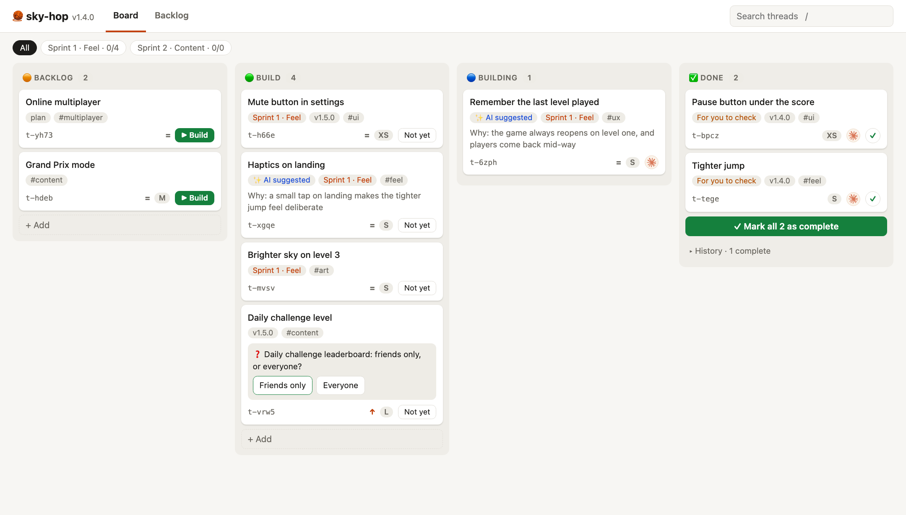
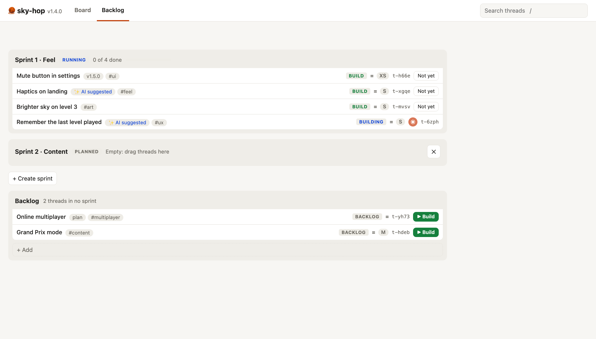
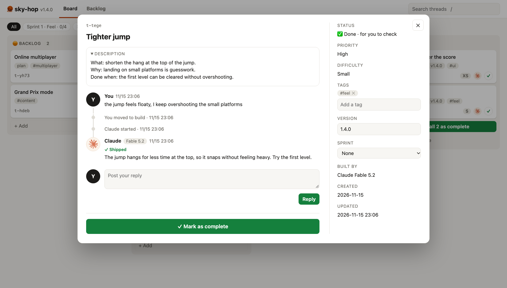

# 🧶 Spool

```text
  ▄▟▀▄██▙▖
▗██▘▟██▀▄▟█▖                    ╷
██▘▟█▛▗█████    ╭───┬─╮ ╭─╮ ╭─╮ │
█▌▐█▛▗█▄▀███    ╰─╮ │ ├─┤ ├─┤ ├─┤
▝▌▐█ ████▖▜───────╯ ├─╯ ╰─╯ ╰─╯ ╰─╴
  ▀▜ ███▛▀          ╵
```

**Tell your agents what you want. Go outside. Come back to it built.**

A spool holds threads. Every idea, bug and feature in your repo is a thread 🧵. Agents propose
them, you pick the ones worth building, and Claude builds them while you do something better.

Spool itself has no cloud and no account of its own: it is plain files in your repo. You bring Claude.



## Already use Claude Code?

```bash
npm install -g spool-ai && spool install
```

Then, in Claude Code inside your project: `/spool-init`, and after it `/spool open the board`. That's it.

Want to see it first, away from your own code? `spool demo --open` makes a throwaway project with a
few threads in it and opens its board.

## New to this? Set up in five minutes

**What you need**

- **A Claude account on a paid plan.** Claude Code, the part of Claude that works on your files, is
  not included in the free plan.
- **A project folder** with the code you want worked on. A git repository is best: git is what lets
  Spool undo a thread.
- **A Mac, Linux or Windows computer.** Spool has been built and tried on macOS so far.

**1. Get Claude Code**

The easy way is the Claude desktop app: [download it](https://claude.ai/download), sign in, open the
**Code** tab, choose **Open folder…** and pick your project.

Prefer a terminal? Install it, then start it inside your project:

```bash
curl -fsSL https://claude.ai/install.sh | bash
```

```bash
cd your-project && claude
```

On Windows, and for every other way to install, see
[Claude Code's own setup guide](https://code.claude.com/docs/en/setup).

**2. Get Node.js**

Spool runs on Node.js 20 or newer. Get it from [nodejs.org](https://nodejs.org), then check:

```bash
node --version
```

**3. Install Spool**

In a terminal, anywhere:

```bash
npm install -g spool-ai
```

```bash
spool install
```

The first downloads Spool, which takes a few seconds. (Prefer the latest source? `npm install -g github:danielportnov/spool`
builds it from GitHub instead, which takes a minute.) The second gives Claude Code five new
commands, called skills. Nothing is added to your project yet.

**Try it first, if you like**

```bash
spool demo --open
```

This makes a small sample project in a temporary folder, a bill splitter with a test, and fills its
spool with threads: some in the backlog, one ready to build, one waiting on a question, a sprint and
two finished. Its board opens in your browser. Drag a thread to Build, press play on the sprint,
answer the question. Nothing is built until a thread is in Build, and to have Claude build it, open
that folder in Claude Code and type `/spool-loop`. None of your own projects are touched, and it
prints how to delete it.

**4. Set up your project**

In Claude Code, with your project open, type:

```
/spool-init
```

Claude reads your project, creates a `.spool/` folder in it for the threads, and tells you what
agents may decide for themselves. It asks who builds: the board by itself (**Headless**), or a
chat where you can watch (**Chat**). It ends by checking that everything a run needs is there.
Claude asks before it runs a command: when it asks about `spool`, choose **Yes, and don't ask
again**.

**5. Open the board, and build something**

```
/spool open the board
```

A board opens in your browser. Press **+ Add** under Backlog and type what you want, in your own
words. Press **▶ Build** on it.

Who builds it is what you picked at set-up, and you can change it at the top of the board.
**Chat**: type `/spool-loop` in the chat and Claude builds it there, where you can watch; keep that
chat open while you want things built. **Headless**: switch **Agents** on and the board builds it
by itself, with [no chat at all](#no-chat-at-all). Either way the card moves to Building, then
Done.

**If something does not work**

| You see | Do this |
| --- | --- |
| `/spool-init` is not in the list | Run `spool install` again, then type `/reload-skills` or start a new chat. |
| `spool: command not found` | Close the terminal and open a new one. Still missing? Node's global folder is not on your PATH: `npm prefix -g` shows where it is. |
| The board did not open | Go to the address Claude printed, usually `http://127.0.0.1:4747`. |
| Nothing gets built | Is the thread under **Build**? Then type `/spool why is nothing building`, or run `spool status`: one line says why. |
| Claude keeps asking permission | Choose **Yes, and don't ask again** for `spool` commands. |
| You do not know what is missing | Run `spool doctor`. It checks git, the agent, your check and the skills, and prints the line that fixes each. After an upgrade it also says when an old skill, or an old Spool block in `AGENTS.md`, is still there. |

## Every day

Got an idea? Put this in front of it, typed or dictated, in any Claude Code chat in the project:

```
/spool-record the jump feels floaty, and I can't see the coins at sunset
```

Two threads land in the backlog, in your words, each in the sprint it serves if there is one. Nothing is built until you move them to Build.

## How it works

| 🟠 Backlog | 🟢 Build | 🔵 Building | ✅ Done |
| --- | --- | --- | --- |
| Every new thread. Yours, or an agent's ✨. | The ones you picked. | An agent has it. | Shipped, and undoable. |

1. **Threads start in the backlog.** Agents size them, explain them and suggest their own. They cannot start them. One you do not want to see, archive: it is kept, out of the way, a click from coming back.
2. **You move a thread to Build.** Drag it, press ▶, or say "build that one". Or group a few into a **sprint** and press ▶ on the sprint. Say what you want a stretch of work to achieve and the agent makes the sprint for you: your words, a goal, and the threads that get there. Above the sprints sit the project's goals, a few lines on where it is heading, agreed with you at set-up: every agent reads them first, and each sprint says which one it serves.
3. **It gets built,** by the board's own agents or by a chat running `/spool-loop`, whichever you picked. In order, three threads at a time where the project is a git repository, each in a worktree of its own; one at a time otherwise. A chat says a line when a thread starts and a line when it ships.
4. **You can take it back.** "Undo that" reverts everything that thread changed, and nothing else. The thread goes back to the backlog, and nothing builds it until you move it to Build. Say why, and the reason is kept as a lesson: every agent reads it before it works, so you never say it twice. `spool lessons` lists them; `spool lessons --drop <n>` forgets one.

The queue has its own local history. Run `spool history <id>` for a thread, note or decision, or
use `policy`, `config` or `goals` for a project file. `spool undo <entry>` restores a previous
copy when the file still matches the entry and records the undo in its history. For a switch or
a change tied to Git or a worktree, the entry points you to the corresponding Spool command.
The journal starts with the next write after the upgrade and records changes made through Spool.

**Nothing is built unless you put it in Build.** That is the contract.

Want that enforced, not just promised? `spool init --lock`. Then the commands that start work run
only for a person: a click on the page, or your own terminal. An agent that tries is refused, so
"build that" in a chat gets you a link to press ▶ on. It stops an agent starting work by mistake or
on its own reading of you; it is not a wall against a program running as you.

## The page

```bash
spool page
```

A board of your spool, served from your own machine, with a Jira-shaped **Backlog** view beside it:
sprints you fill by dragging and start with one ▶. Sprints have no dates; agents work in hours, so
a sprint is over when its threads are done, and becomes a version named for it. The **Roadmap** view
puts them in a row under your goals: the ones reached, the one being played with each of its
threads and how far along it is, and the ones to come, each with its ▶. A sprint reached opens its
**review**, to read as one piece of work: what it was for, what each thread did and how to check
it, with a tick list for you, the calls agents made, and **Approve the sprint**. On the board, drag threads between Backlog and Build, drag a card
up or down in Build to say what is built first, add one with **+ Add**, answer an agent's question on its thread with one button. It all works from the keyboard too: `c` adds a thread from anywhere, `Cmd+K` finds any thread or action, and `?` lists the keys. Open any card and you get the
ticket: what you said, what was done and by which agent, everything in between, and its fields at
the side — status, priority, difficulty, tags, version — all yours to change. Click a tag or a
version to narrow the board to it. Reply on a thread, say **Fine** to a call an agent made there or
overrule it in a sentence, and press **Mark as complete** when you have looked at the change. Agents keep working while it is
open, and you watch threads move.

Much feedback is about how something looks, so a picture can go with it: paste a screenshot, or
drop an image file, into the reply box, **+ Add** or `c`, and it waits under the box until you send.
It shows under your words in the conversation, a click opens it full size, and the agent that builds
the thread finds its path in its brief. A file goes the same way, dropped on the thread or picked
with **Add a file**: a PDF, or plain text such as a log, notes, a CSV or JSON. It shows as a link,
and a chat that is building the thread is told its path the moment you send it. Agents attach pictures too, with `spool attach`: a before and
an after of anything that changes what is on screen, shown side by side under the result when the
thread is done, and counted in the **★ Worth a look** mark on its Done card. Pictures stay on your machine, in
`.spool/runs/`, out of git.

Keep several projects in one folder, each with its own spool? Start `spool page` in that folder and
it shows them all: **All projects** first, a row each with what is building and what its agent last
said, what needs you, what is done for you to check and how far its sprint has got, and above them
the brief across every one. Click a row, or pick a project from the menu on its name in the bar,
for that project's board; the address names it (`?project=apps/tidy_up`), so a link opens the right
one. What you do on one project's board is done to that project and no other. The page's agents
build every project under it: three threads at a time for the whole page, each in a worktree of its
own, and one at a time in a project that is not a git repository, which takes one of the three while
it builds. Each board says how many at once its project gets. Headless or Chat is picked per project.





The pictures are a made-up project.

### In the background

```bash
spool page -d
```

`-d` starts the page in the background and comes back at once with its address. No browser pops
up, there is no terminal to keep open, and it stays up after the terminal or the chat that started
it has gone: with a chat building, every change is a command, and the page is only for looking in
when you want to. `spool page --status` says whether one is up for this project, where, since when,
and who builds; `spool page --stop` ends it, as Ctrl-C would. One page to a project: starting
another while one is up gives you the address of the one that is up, and plain `spool page` opens
it in your browser. A page started at the top of a folder of projects is the page of every one of
them, so these commands, `spool status` and `spool agents` inside any of them find it and use it.

## In the terminal

```bash
spool
```

Typed in a terminal with nothing after it, `spool` opens the queue full-screen: what needs you,
what is being built and each agent's last line, Build in the order it will be built, what is done
and waiting for your check, and the backlog, which Enter opens to a list. Beside it is whatever
the cursor is on. On a thread being built that is its agent's session, live: every line it has
said, the newest at the foot.

```
 ▐▚▌── spool · skyhop 0.16.0   agents on · 2 building · 2 need you · page :4747
────────────────────────────────────┬───────────────────────────────────────────
 NEEDS YOU  2                       │ t-4kq7  Tighter jump     opus · high · 6m
  ? d-9d2a  Which font for the… 1-3 │ .spool/worktrees/t-4kq7  session 3b7f38ef
  ! t-e2b7  Credits screen  stopped │───────────────────────────────────────────
                                    │ Reading the jump code first.
 BUILDING  2 of 3                   │ → Read: src/player/jump.ts
> * t-4kq7  Tighter jump         6m │ → Edit: src/player/jump.ts
     The small platform is 3px too… │ Gravity is up from 28 to 34 at the top
  * t-b81c  Coins at sunset      2m │   of the arc.
     The coins use the noon sprite… │ → Bash: npm test
                                    │ ✗ 1 test failed: "clears the small
 BUILD  2              sprint: Feel │   platform"
  1 t-c0de  Double jump           m │ The small platform is 3px too far now.
  2 t-e2b7  Credits screen  stopped │   Shortening the hang time instead.
                                    │
 DONE, TO CHECK  2                  │
  + t-5aa1  Coyote time     +38 -12 │
  + t-0b2c  Fix wall clip     +6 -2 │
 BACKLOG  5                         │
────────────────────────────────────┴───────────────────────────────────────────

 s stop its agent · tab its session · pgup/pgdn scroll it
 up/down move · g agents · / add · ? keys · q leave, agents carry on
```

`b` sends a backlog thread to Build, `p` plays a sprint, `s` stops an agent, `a` approves a
finished thread, `1` to `9` answer a question, `/` adds a thread, `g` switches agents on or off,
and `?` lists every key. Each is a button of the page, pressed from here. `Tab` goes into the
session and back; `PgUp` scrolls it, and it holds still while the agent goes on, until `End`
follows it again.

It is a face of the page, not a second runner. With no page up it starts one in the background,
agents off unless you typed `spool --run`, and `q` leaves it running: your agents carry on. When
something shipped while you were away and nothing is being built, it opens on the brief. Piped, or
run by an agent, `spool` alone prints the status as it always did, and `spool --plain` prints it
anywhere.

## No chat at all

```bash
spool page --run
```

With `--run`, or the **Agents** switch at the top of the page, the page builds what is in Build by
itself: it starts your agent on each thread the moment it lands there, shows what it prints on the
card, and puts a Stop on the card that ends that agent and no other. Reply on a thread while it
is being built and a `claude -p` agent hears you and adjusts. A stopped thread carries on
where it was: the agent picks its own session up again. So does one that was cut off, when the
page is killed or the machine goes down, the next time the page starts. Three threads at a time, each
in a git worktree of its own so that no two agents edit one folder, and each lands on your branch
when its agent finishes; `spool builder --at-once <n>` sets how many. A project that is not a git
repository is built one thread at a time, in its own folder. On a page over a folder of projects,
the number is for the whole page, shared across them. Close every chat; press ▶; come back
to Done. From a terminal or a chat, `spool agents on` and `spool agents off` press the same switch,
and `spool agents` says where it is.

Next to that switch you pick who builds. **Headless** is the above: the page starts the agent
itself. **Chat** hands building to a Claude Code chat running `/spool-loop`, where you can watch
the work and step in; the page then starts nothing, and the switch says whether a chat is building,
watching, or not there. The pick is kept for the project. Say "switch to chat mode" to a chat and it
runs `spool builder chat`; "let the page build" is `spool builder headless`.

In Chat mode Claude and Codex can build at once. The header shows each with what it is building of
its thread count, and − and + to change it; one with no chat watching is greyed.
`spool builder --agent Codex --at-once 2` sets it from a chat, and a claim past it is refused.

In Chat mode the header also holds a **usage target**: how much of your Claude plan the chat may
use, as a percent of the weekly limit, the 5-hour limit, or both. Set it with the slider or type the
number. Before each thread the chat reads the plan's usage with its own tool (`get_usage` in the
Claude app) and reports it with `spool usage`; once a target is reached it takes no new thread, and
the header shows the usage against the target. `spool target --weekly 80` sets it from a chat or a
terminal. Spool never reads your usage or your account itself: it keeps what the chat reports.
An agent that runs out mid-thread hands it off (`spool handoff`): its work is committed, and the
thread goes back to Build for another agent or a smaller model to carry on from its note.

Beside it, **Take over** lets the chat fill Build for you. Switched on, from its menu in the header
or by saying "take over the backlog", the chat that builds moves the top thread you filed to Build
itself whenever Build is empty and the usage is under the target, and builds it; it stops once the
target is reached. Never an AI suggested thread, one on hold, or one waiting on a question or a
plan's go-ahead. Each one says on its thread that the chat moved it, the brief lists it as worth a
look, and `spool revert` takes it back. `spool takeover on` and `off` are the same switch.

**Caveman mode** (`spool caveman on`, or say "caveman" to the chat) makes the chat that steers or builds
answer in the fewest words, as short fragments. `spool caveman off` returns to normal replies.

**AFK** (`spool afk on`, say "I'm AFK" to the chat, or tick "I'm AFK" in the take-over menu) is for
when you are away and don't want to be pinged. An agent that would ask you takes its own
recommendation instead, records it as a call you can overrule in your review, and keeps going, in
every project, Headless or Chat. Only what is truly yours still asks and notifies: spending money,
publishing or pushing, deleting what cannot come back, a new account or service, what the product
is, and your own accounts or machine. The agent marks those `spool ask --human <kind>`.
`spool afk off`, or "I'm back", and questions are asked again.

The **bell** by the theme picks what notifies you, in every project: a thread started, a thread
done, a question, a sprint finished, Build empty, an agent stuck or refused, a run stopped at its
usage target. Out of the box, only what needs you: questions, Build empty, stuck, the target. In
Chat mode the chat that builds sends each one you picked as a single-line Claude notification and
nothing for the rest; headless, the page runs your notifier for them. Tell a chat "notify me when a
thread starts" and it runs `spool notify on started`.

**Settings**, the gear in the header (or ⌘K, "Open settings"), gathers every choice about how
the spool runs in one panel: who builds and whether Headless is offered, threads at once for each
agent, taking over the backlog, rebuilding after each landing, the quiet-agent minutes, the usage
targets, what notifies you, caveman mode and quick replies. Each row says what it does and the
command that does the same. `spool settings` lists the ones that had only a line in the config
file, and `spool settings quick-reply off`, `rebuild off`, `headless on` or `quiet-minutes 15`
sets one.

The agent it starts is a command on your machine, `claude -p` unless you say otherwise, and it can
only do what you allow it. What you have not allowed, it asks for while the page is open: the
question shows on its card, with **Allow once**, **Allow for this run** and **No**. With nobody
at the page it is refused, so nothing waits on you overnight. To let it edit files and commit
without asking, say so once in `~/.config/spool/config.json`:

```json
{ "agent": "claude -p --permission-mode acceptEdits --allowedTools 'Bash(spool *)' 'Bash(git *)' Edit Write Read" }
```

## Other agents

Spool is built with Claude Code, and Claude Code is the only agent it is tried with end to end
every day. The skills are plain [Agent Skills](https://agentskills.io), so other agents can load
them too:

```bash
spool install --for codex     # or cursor, gemini, or all
```

| Agent | How it gets Spool | Where |
| --- | --- | --- |
| Claude Code | Native skills: `/spool-init` | `~/.claude/skills` |
| Codex | Native skills: `$spool-init` | `~/.codex/skills` (or `$CODEX_HOME/skills`) |
| Cursor | Native skills, in its agent: ask for spool-init | `~/.cursor/skills` |
| Gemini CLI | The Spool block in `AGENTS.md`, and `spool prime` | nothing is installed |
| Anything else | The same: `AGENTS.md`, `spool prime`, and `spool mcp` for an agent with no shell | |

`--here` puts the copies in the project instead (`.codex/skills`, `.cursor/skills`), to check in
for a team. `--for all` installs for Claude Code and every other agent found on this machine, and
plain `spool install` names the ones it found. `spool doctor` says, for each, whether Spool is
installed for it.

For Codex and Cursor, the folders were read off the agents themselves: Codex lists the installed
skills, and Cursor's agent loads that folder. A whole project has not yet been built through
either. Gemini CLI has not been checked at all, so Spool writes nothing for it rather than guess.
It reads `GEMINI.md` unless its settings name `AGENTS.md` too.

## While you're away

- ⚡ The loop watches the spool. Press ▶ on the page and it starts within seconds; no timer, nobody typing.
- 🔔 It notifies you of what you pick, in one line each: a thread started or done, a question, a sprint finished, Build empty, an agent stuck, the usage target reached. By default only what needs you; the bell on the board changes it.
- ❓ A question stops one thread, never the loop. It asks with options and a recommendation, and moves on. In Chat mode it comes to you in the chat, with a notification.
- 🧾 A call it makes by itself leaves a receipt you can overrule.
- ✅ Name your tests once (`spool checks "npm test"`) and no thread can be marked done unless they pass.
- 🏷️ What ships gets a version: a bump, a changelog entry, and a tag that stays on your machine.
- 🧹 The backlog can be put in order while you sleep. `spool manage` hands an agent the facts: what
  may already have shipped, what looks alike, what has no size, what has gone cold. The agent
  sizes, sorts and proposes, and its report is on one thread in the morning. How far it may go is
  yours to say, in your words and until a time:
  `spool leave "work through what still seems relevant" --until 8am --build 5` lets it move up to
  five threads to Build and no more, and with no leave it only tidies. One undo takes the whole
  night back. Its rules are one file, which `spool prime manager` prints.
- 💡 Ask for new ideas ("come up with ideas") and `spool ideate` hands an agent the project's goals,
  what shipped, what is already there, what you said and what you said no to. It files a handful
  of ideas as AI suggested, each with its reason, and none is built until you move it to Build.
- 🌅 Back in the morning? Ask "catch me up", or run `spool brief`: one screen with what shipped,
  the few threads worth checking, why, and the two or three steps to see each one working, and
  what needs you. `spool approve --all` clears it.
  The board opens with the same brief above its columns, each line a click from its thread, and
  one button to approve the lot.

## Skills

You use Spool by talking to Claude. There are six skills, short enough to read: [`skills/`](skills).

| You type | What it is for |
| --- | --- |
| `/spool-init` | Sets Spool up in a repo, or in a folder of repos, and asks who builds. Once. |
| `/spool` | Whatever you want to say about the spool or the board, in any chat: "open the board", "build that one", "what needs me", "catch me up", "why is nothing building", "switch to chat mode". The answer is a few lines; the detail is on the board. |
| `/spool-loop` | Makes that chat the builder: it builds what is in Build, several threads at once, then watches for more. |
| `/spool-lazy` | Lazy dev mode, in that chat: Claude decides how, never asks, builds what you moved to Build, and shows you screenshots and a line or two. You react, and it files your words as threads. `/spool-lazy off` ends it. |
| `/spool-record <idea>` | Files one message as threads, in your words. The chat carries on as it was. |
| `/spool-steer <instruction>` | Steers how the work is handled without recording it. Pass steering for an active thread to its builder. |

Upgrading? `spool install` brings your copies up to date and takes away a skill that has been
retired, and `spool doctor` says if an old one, or an old Spool block in `AGENTS.md`, is still there.

## Not every project

Spool is one tool, not the only way to work. In a project where you don't want it, `spool disable`
switches it off: the Spool block comes out of `AGENTS.md` and `CLAUDE.md`, so no agent is sent to
the queue, and its commands refuse. The queue is kept as it was, and `spool enable` turns it back
on. In a folder of projects, `--all` does every one of them at once.

## Under the hood

- **Plain files.** One markdown file per thread in `.spool/`, ignored by git unless you choose to share it.
- **A small CLI.** `spool` holds the queue, the lock, the order and the undo. The skills run it; you rarely type it.
- **Several at once.** Each thread the page builds gets a git worktree of its own, three at a time unless you say otherwise, and lands on your branch when its check passes there; a chat does the same with `spool start <id> --worktree`. Agents work side by side without touching each other's files.
- **Any agent.** The skills are plain [Agent Skills](https://agentskills.io), installed for Codex and Cursor too ([other agents](#other-agents)). `spool mcp` serves the same commands as tools to an agent with no shell, and `spool loop` runs with no chat at all.
- **Your machine.** A repo's config is data and is never executed. The page listens on `127.0.0.1` only.

The long version, with every idea and every command: [how it works](docs/how-it-works.md).

## Status

Early, and moving fast. Built on macOS with Claude Code. Not on npm yet, and not tested on Windows.
See the [changelog](CHANGELOG.md).

## Develop

```bash
npm install
npm test        # node --test, straight from the TypeScript sources
npm run check   # tsc
```

No runtime dependencies. PRs and issues welcome.

Want to fix something? Start with [CONTRIBUTING](CONTRIBUTING.md) and [a tour of the code](docs/architecture.md).

## License

MIT
