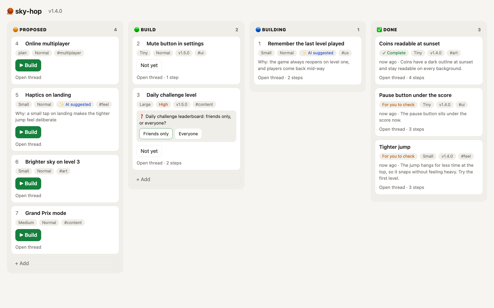

# 🧶 Spool

**Tell your agents what you want. Go outside. Come back to it built.**

A spool holds threads. Every idea, bug and feature in your repo is a thread 🧵. Agents propose
them, you pick the ones worth building, and a loop builds them while you do something better.

No cloud. No account. No dependencies. Plain files in your repo and four commands.



## Quickstart

```bash
npm install -g github:danielportnov/spool && spool install
```

Then in Claude Code, inside any project:

```
/spool-init     set it up, once
/spool-page     open the board, press ▶ on a thread, and it gets built
```

That's the whole thing. Got an idea? Put this in front of it, typed or dictated:

```
/spool-record the jump feels floaty, and I can't see the coins at sunset
```

Two threads land in the spool, in your words.

## How it works

| 🟠 Proposed | 🟢 Build | 🔵 Building | ✅ Done |
| --- | --- | --- | --- |
| Every new thread. Yours, or an agent's ✨. | The ones you picked. | An agent has it. | Shipped, and undoable. |

1. **Threads start proposed.** Agents size them, explain them and suggest their own. They cannot start them.
2. **You move a thread to Build.** Drag it, press ▶, or say "build that one".
3. **The loop builds it.** One thread at a time, in order, a line when it starts and a line when it ships.
4. **You can take it back.** "Undo that" reverts everything that thread changed, and nothing else.

**Nothing is built unless you put it in Build.** That is the contract.

## The page

```bash
spool page
```

A board of your spool, served from your own machine. Drag threads between Proposed and Build, add
one with **+ Add**, answer an agent's question with one button. Open any card and you get the
ticket: what you said, what was done and by which agent, everything in between, and its fields at
the side — status, priority, difficulty, tags, version — all yours to change. Click a tag or a
version to narrow the board to it. Reply on a thread, and press **Mark as complete** when you have
looked at the change. Agents keep working while it is
open, and you watch threads move.


Both pictures are a made-up project.

## While you're away

- ⚡ The loop watches the spool. Press ▶ on the page and it starts within seconds; no timer, nobody typing.
- 🔔 It notifies you when Build is empty, or when it needs a call that is yours.
- ❓ A question stops one thread, never the loop. It asks with options and a recommendation, and moves on.
- 🧾 A call it makes by itself leaves a receipt you can overrule.
- 🏷️ What ships gets a version: a bump, a changelog entry, and a tag that stays on your machine.

## The four skills

| | |
| --- | --- |
| `/spool-init` | Set Spool up in a repo, or in a folder of repos. Once. |
| `/spool-page` | The board. Where you plan and decide what gets built. Opening it starts the loop. |
| `/spool-loop` | The loop by itself, with no board: builds what is in Build, then watches for more. |
| `/spool-record <idea>` | Files one message as threads. The chat carries on as it was. |

## Under the hood

- **Plain files.** One markdown file per thread in `.spool/`, ignored by git unless you choose to share it.
- **A small CLI.** `spool` holds the queue, the lock, the order and the undo. The skills run it; you rarely type it.
- **Any agent.** The skills are plain [Agent Skills](https://agentskills.io). `spool mcp` serves the same commands as tools to an agent with no shell, and `spool loop` runs with no chat at all.
- **Your machine.** A repo's config is data and is never executed. The page listens on `127.0.0.1` only.

The long version, with every idea and every command: [how it works](docs/how-it-works.md).

## Status

Early, and moving fast. Built on macOS with Claude Code. Not on npm yet, and not tested on Windows.
See the [changelog](CHANGELOG.md).

## Develop

```bash
npm install
npm test        # node --test, straight from the TypeScript sources
npm run check   # tsc
```

No runtime dependencies. PRs and issues welcome.

## License

MIT
