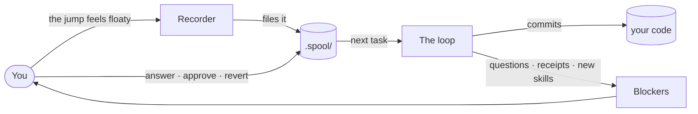

# Spool

**You talk. Agents turn it into work, keep working, and come back only for the calls that are yours.**

Spool is a handful of agent skills, and a small CLI underneath them, that keep coding agents working
on a project by themselves. You say what you want the moment you have it — while playing the build,
from your phone, by voice. A *recorder* files it. A *loop* works it, task after task, and stops only
when nothing can move without you. When an agent reaches a choice, it either makes the call and leaves
a receipt, or asks you and gets on with something else. Anything it ships can be taken back in a
sentence.

Not everything you say is "change this". "Play the whole thing as a new player and tell me what would
make them quit" is an audit; "we need multiplayer" is a plan. Spool treats both as first-class work
that ends in sized, ordinary tasks — and schedules those so quick wins land first while the large
things keep moving.



Agents are fast now. The slow part is the person: writing specs up front, re-explaining context,
sitting at a keyboard approving things. Spool is built on one idea — **your attention is the scarce
resource** — and spends it only on judgment. No daemon, no database, no account, no runtime
dependencies.

## The skills

You use Spool by talking to your agent. Five skills, and one that lists them:

| Skill | What it does | Use it |
| --- | --- | --- |
| `/spool-init [folder]` | Sets Spool up in this folder or repo, or in one inside it that you name | once per project |
| `/spool-recorder` | Turns a chat into the recorder: talk or type, and everything is filed as work | whenever you have feedback or an idea |
| `/spool-loop [hours]` | Agents work the docket until nothing can move without you, and come back every `hours` | to get work going, and keep it going |
| `/spool-blockers` | Walks you through what agents need from you: questions, go-aheads, anything to undo | when the loop says it is waiting on you |
| `/spool-overview [project]` | The whole docket, colour-coded: needs you, blocked, in progress, ready, on hold | any time |
| `/spool-help` | This table, and what to do next here | when you forget |

**init** once, **recorder** to fill the docket, **loop** to work it, **blockers** when it needs you.

They are plain [Agent Skills](https://agentskills.io) in [`skills/`](skills): read them, edit them.
The `spool` command is the engine they run. It holds the queue, the lock, the scheduler and the undo —
the parts that must not be improvised — and once it is installed you should rarely type it.

## Install

Node 20 or newer. Not on npm yet; install from GitHub, which builds from source:

```bash
npm install -g github:danielportnov/spool
```

```bash
spool install
```

`spool install` copies the skills to `~/.claude/skills`, where Claude Code finds them from every
project. Use `--dir <path>` for another harness's skills directory, or `--here` to check them into one
project for a team. Run it again after upgrading: copies you have not edited are refreshed, and ones
you have are kept.

Then, in your agent, in any project:

```
/spool-init
```

From a folder of projects, name the one you mean, however you would say it: `/spool-init sky hop`
sets up `games/sky_hop`. Run it where Spool is already set up and it changes nothing, and says so.

## What it looks like

> **You:** /spool-recorder
>
> **You:** the jump feels floaty, and I can barely see the coins at sunset
>
> **Recorder:** Filed two things for Sky Hop: tighten the jump, and make the coins readable at sunset.

In another chat, or the same one later:

> **You:** /spool-loop 2
>
> **Agent:** *(works both)* The jump is tighter — gravity 9.8 → 12, try the first level. One thing
> needs you: how to make the coins readable. I'll look again in two hours.
>
> **You:** /spool-blockers
>
> **Agent:** One question, holding up one task. At sunset, should coins get a dark outline, or shift to
> teal? The agent recommends the outline: it works on every background, and teal changes the look of
> the game.
>
> **You:** outline. and the jump is too heavy now, I wanted snappy, not heavy
>
> **Agent:** Outline it is, and that task is ready again. I've undone the jump change and put it back
> at the front of the queue with your words attached.

At any point, `/spool-overview` shows where everything stands:

```console
skyhop  4 open · 1 on hold · 2 done

🔴 NEEDS YOU  1
  Coins at sunset: outline them, or change their colour?  · a question · blocks 1 task

🟣 BREAK DOWN  1
  plan: Add online multiplayer  · not planned yet: an agent will plan it, or talk it through first

🟡 BLOCKED  1
  Make coins readable at sunset  · waiting on your answer: “Coins at sunset: outline them, or change…”

🔵 IN PROGRESS  1
  Tighten the jump arc  · claude, 5m

🟢 READY  1
  1. Pause button overlaps the score

⚪ ON HOLD  1
  A Grand Prix mode  · “just an idea; try it when I say”
```

### Underneath

Every line of that conversation was a verb on the queue. The rest of this page shows that layer —
what agents run and what they read — because it is where the guarantees are.

You say something. The recorder captures your words exactly and splits them into work:

```console
$ spool capture "the jump feels floaty, and I can barely see the coins at sunset"
n-jzbk captured in skyhop's inbox.

$ spool task "Tighten the jump arc" --from n-jzbk --size s -p 1
$ spool task "Make coins readable at sunset" --from n-jzbk --size s
```

Workers pick those up with `spool next --claim`, commit with a `Spool: <task-id>` trailer, and report
back. One made a call on its own; one needs yours. Hours later, this is everything waiting for you:

```console
$ spool review
NEEDS YOU  work is stopped on these
  d-vvn7  Coins at sunset: outline them, or change their colour?  · blocks 1 task
      1) Dark outline  ← recommended
      2) Shift coins to teal while the sun is low
      An outline works on every background; teal changes the look of the game
      spool answer d-vvn7 1

WENT AHEAD  approve, or say what you want instead
  d-bnw7  How should the jump be tightened?
      chose: Raise gravity 9.8 → 12, keep the height
      Shorter hang time without changing what the player can reach
      spool approve d-bnw7   ·   spool answer d-bnw7 "<what you want>"

SHIPPED  nothing to do unless you dislike it
  t-hcta  Tighten the jump arc  · 1 commit
      Gravity 9.8 → 12. The jump lands about 20% sooner — try the first level.
      spool revert <id> -m "<why>"

all good?  spool approve --all   (2 items)
```

You answer the question, try the build, and don't like the jump:

```console
$ spool answer d-vvn7 1
d-vvn7 decided: Dark outline
Now ready:
  ○ t-2r3q  p2 S  Make coins readable at sunset

$ spool revert t-hcta -m "too heavy now. I wanted snappy, not heavy"
t-hcta reverted — 1 commit(s) undone in one new commit.
  dropped the assumption behind it: d-bnw7 Raise gravity 9.8 → 12, keep the height
It is back in the queue at p1 with your reason attached.
```

The code is back where it was, the task is back at the front of the queue, and the next agent to pick
it up is briefed with both things you said.

## The ideas

### Every interruption has to earn your attention

A worker that reaches a choice the task doesn't settle has two moves, and the difference between them
is the whole product:

| The choice is… | The agent runs | What happens | What you do |
| --- | --- | --- | --- |
| easily undone, and within policy | `spool assume` | It decides and keeps working. The call is on record. | Say it's fine — or say what you wanted, and the rework is queued for you. |
| yours to make | `spool ask` | That task stops; every other task continues. You get a notification with options and a recommendation. | Answer in a word. |

Finished work is a third lane: it needs nothing from you unless you dislike it.

Where the line falls is written in `.spool/policy.md` — plain prose, yours to edit, read by every
worker before it starts. The default lets agents assume anything one revert undoes, and makes them ask
before spending money, publishing, deleting, adding dependencies, or deciding matters of taste.

### Not everything is a task

Feedback from real use is a fire hose, and much of it is not a specific change. A task has a **type**,
which says what finishing it produces:

| Type | You say something like | Finishing it produces |
| --- | --- | --- |
| `change` | "the jump feels floaty" | commits |
| `audit` | "play the whole thing as a new player and tell me what would make them quit" | a report, and each finding filed as its own task |
| `plan` | "we need online multiplayer" | a plan, and its parts filed as tasks |

The recorder picks the type when it files what you said, and the worker's brief spells out what done
means for it. An audit does not fix what it finds and a plan does not build: each turns one open-ended
ask into sized, ordinary tasks that the queue already knows how to handle.

```console
$ spool audit "Play the whole game as a new player: what would make them quit?" --from n-9c4c
  ○ t-h3pr  p2 M  audit: Play the whole game as a new player: what would make them quit?
$ spool plan "Add online multiplayer" --from n-9c4c
  ○ t-f9j8  p2 XL  plan: Add online multiplayer
```

Workers pick both up like anything else. When they are finished:

```console
$ spool review
PLANS  the parts wait for your go-ahead
  t-f9j8  Add online multiplayer  · 3 parts
      Two-player races over a relay server; no accounts in the first version.
        M   Relay server and a connection test
        S   Lobby screen
        L   Matchmaking by skill
      read .spool/reports/t-f9j8.md
      spool approve t-f9j8   ·   spool revert t-f9j8 -m "<what to change>"

SHIPPED  nothing to do unless you dislike it
  t-h3pr  audit: Play the whole game as a new player: what would make them quit?
      Most new players would quit at the first boss: it needs a move the game never teaches.
      read .spool/reports/t-h3pr.md  · 3 findings filed
      spool revert <id> -m "<why>"
```

The audit's three findings are already in the queue. The plan is holding its parts: a part filed with
`--needs <plan>` waits for your go-ahead, and the policy says when that is warranted — a new direction,
or more than a few days of work. A plan is never swept up by `approve --all`. Send one back with
`spool revert` and its unstarted parts go with it.

### Quick wins first, large work always moving

Every task has a **size**, `xs` to `xl`: how much would have to change. The recorder estimates it and
the worker corrects it. The scheduler turns it into an order:

- **Priority first.** It is your urgency; a p1 never waits behind p2 quick wins.
- **Then the smallest.** Quick wins are the cheapest progress there is.
- **One pick in four goes to large work** — an `l` task, or a part of a plan — however many small
  things are waiting. (`largeEvery` in `.spool/config.json`.)
- **Nothing `xl` is built in one go.** It is filed as a plan, and its parts are what get built.

```console
$ spool approve t-f9j8
$ spool status
for you: 1 shipped  → spool review

skyhop  6 ready · 0 active · 2 blocked · 2 done
  ○ t-67vb  p1 M  The first boss is a difficulty wall
  ○ t-ezh3  p2 M  Relay server and a connection test
  ○ t-raka  p2 XS  Coin magnet radius is too small
  ○ t-vj9n  p2 S  Pause button overlaps the score
  ○ t-rzs5  p2 S  The tutorial never explains the double jump
  ○ t-gz7d  p2 L  Nothing to spend coins on after level 3
  … 2 more — spool list -P skyhop
  ◧ t-f9j8  XL  Add online multiplayer  · 0/3 parts done
```

That list is the order `spool next` will hand the work out: the urgent finding, then the first part of
the multiplayer plan taking its turn, then the quick wins smallest first. The last line is the large
work itself, whose progress is simply its parts. Whose turn it is comes from timestamps on the tasks;
there is no counter to keep.

### Not yet is a state

Some of what you say is an idea to keep, not work to start: "maybe eight racers, but don't build it
yet", or everything that isn't the launch. That work goes **on hold** with your reason attached. It
stays in the queue, is never handed to a worker, and — unlike a question — asks nothing of you until
you say go.

### Everything can be taken back

Agents end each commit message with `Spool: <task-id>`. That one line ties work to the task that asked
for it and, unlike a recorded hash, survives a rebase. "Undo that" becomes `spool revert <task>`, which
finds those commits and undoes them in a single new commit. It is designed for a repository that is in use:

- It reverses only the files that task's commits changed, and only those files need to be clean. An
  agent halfway through something else is not in the way.
- It never touches `.spool/`. The queue is a record of what happened; undoing code does not rewrite it.
- It is all or nothing. If later work conflicts, every file is put back and nothing is committed.
- The task reopens at higher priority with your reason quoted in it, and any unconfirmed assumption
  the work was built on is dropped, so the second attempt isn't briefed to repeat the first.

### Two roles: a recorder and workers

The **recorder** is a chat you leave open — a mid-sized model is plenty. You dictate; it captures your
exact words, works out which project and which task they belong to, and files them. It never does the
work. That is `/spool-recorder`, and its scope is wherever you start it: one repository, or a folder
of them.

**Workers** take tasks off the queue, and `/spool-loop` is a worker that keeps taking them. It ends a
pass only when nothing is ready, and a question on one task never stops the rest.

The rules for both are written once, in those two skills. An agent whose harness has no skills gets
the same text from the engine, so any agent that can run a command can play either role:

```bash
claude --model sonnet "$(spool prime recorder)"
```

### Skills compound

Spool's own skills are how you use it. Agents can add more. When an agent works out a multi-step procedure — shipping a beta, regenerating assets — it can write
it down as a standard `SKILL.md`, which your harness loads natively from then on. Spool adds the part
the format lacks, a ledger:

```console
$ spool skills
games/sky_hop  1 skill
  ◆ ship-to-testflight  Build and upload a TestFlight beta. Use when asked to ship, release o…
                        s-9qap · by claude · from t-j586 · used 1× · new · .claude/skills/ship-to-testflight
```

Every skill records which task taught it, who wrote it and how often it has been used. New ones show
up in `spool review` like anything else done on your behalf: approve, or drop and it is deleted. A
task's brief lists the skills that fit it, and in a workspace a skill at the top is available to every
project below. Skills you wrote by hand are listed too.

### Blocked is computed, never stored

A task has no "blocked" status. It lists what it `needs`, and whether it is ready is worked out from
those items each time someone asks. Answer a question and everything behind it is ready in the same
instant; there is no second field to forget to update, and no state to repair.

### Plain files, one per item

```markdown
---
id: t-hcta
kind: task
title: Tighten the jump arc
status: open
priority: 1
size: s
created: 2026-11-15T17:23:03.569Z
updated: 2026-11-15T17:23:04.286Z
started: 2026-11-15T17:23:03.711Z
from: [n-jzbk]
---

> the jump feels floaty, and I can barely see the coins at sunset
> — [[n-jzbk]], 2026-11-15

> too heavy now. I wanted snappy, not heavy
> — on reverting the first attempt, 2026-11-15

## Log
- 2026-11-15 17:23Z claude: started
- 2026-11-15 17:23Z claude: assumed d-bnw7: How should the jump be tightened? → Raise gravity 9.8 → 12, keep the height
- 2026-11-15 17:23Z claude: done: Gravity 9.8 → 12. The jump lands about 20% sooner — try the first level.
- 2026-11-15 17:23Z human: reverted 1 commit(s): too heavy now. I wanted snappy, not heavy
```

Four kinds of item — `note` (what you said, verbatim), `task` (with its type and size), `decision`,
`skill` — linked by `from` (where it came from) and `needs` (what must be settled first). That makes the store a small typed
graph: `spool graph` draws it, and because the links are `[[wikilinks]]` the folder opens as an
Obsidian vault.

- **Git is the history.** One small file per item diffs and merges cleanly.
- **Ids are random** (`t-hcta`), so two agents or two branches adding items never collide.
- **Agents never write these files.** They use verbs — `ask`, `assume`, `done` — and the CLI enforces
  what may follow what, so no agent can leave the queue in a shape the next one can't read.
- **Fields Spool doesn't own are kept.** Add `tags:` in your editor and they survive every rewrite.
- **Writes are atomic and locked**, so a recorder and several workers can share one queue.

### One project, or a folder of them

A workspace is the spool you are standing in plus every spool below it. Nothing is registered:

```console
$ cd ~/code/studio && spool status
studio · 3 projects
for you: 1 question blocking 1 task  → spool review

studio  no tasks yet

apps/tidy_up  no tasks yet

games/sky_hop  1 ready · 1 active · 1 blocked · 0 done
  ▶ t-ecpj  p1  Tighten the jump arc  · claude, now
  ○ t-s3gm  p2  Coin magnet radius is too small
  ◌ t-ac73  p2  New title screen  · needs d-3jwn
```

Run from the top and you see, record into and loop over everything; run from inside one project and
you see just that one. A recorder at the top routes each thing you say to the right project.

### A repository's config is never executed

Spool can start two programs: a notifier and an agent. Both are configured only on your own machine —
an environment variable or `~/.config/spool/config.json` — never in `.spool/config.json`. Cloning a
repository and running `spool` in it cannot run that repository's code.

## Running it

**Notifications.** Set a command and Spool runs it when a worker asks you something, or when the loop
runs dry with questions outstanding. Details arrive in `SPOOL_EVENT`, `SPOOL_TITLE`, `SPOOL_ID` and
`SPOOL_PROJECT`:

```json
{ "notify": "curl -s -d \"$SPOOL_TITLE\" https://ntfy.sh/your-private-topic" }
```

**The loop, in a chat.** `/spool-loop 2` works the docket now and every two hours after, using your
harness's own scheduler (in Claude Code, `/loop`). A pass takes the next task, does it, hands it in and
takes the next, until nothing is ready. A pass that finds nothing costs one command, so it is cheap to
leave running: answer a question from your phone, and the next pass picks the work up.

**The loop, with no chat.** The engine has a runner of its own. It contains no agent and doesn't care
which one you use: `spool loop` claims the next ready task, starts your agent in that task's project
with the rules and the brief on stdin, and looks at the queue again when it exits:

```bash
spool loop                 # until nothing is ready
spool loop --watch 300     # forever: look again every five minutes
spool loop --dry-run       # what would it do?
spool loop --agent 'claude -p --permission-mode acceptEdits --allowedTools "Bash(git *) Bash(spool *)"'
```

The default agent is `claude -p`; anything that reads a prompt on stdin works. What the agent is
allowed to do is your harness's business, not Spool's. A task the agent finishes is done; one it asks
a question on waits for you; one it walks away from is released and not retried until something
changes. The lock is never held while an agent runs, and each task gets a fresh agent.

**MCP, for an agent with no shell.** A chat app on your phone cannot run a command. `spool mcp` gives
it the same verbs as [Model Context Protocol](https://modelcontextprotocol.io) tools: `spool_capture`,
`spool_review`, `spool_answer` and the rest, one tool per command, each answering with the JSON that
command returns under `--json`. Point your MCP client at it, and at the project:

```json
{
  "mcpServers": {
    "spool": { "command": "spool", "args": ["mcp", "-C", "/path/to/your/project"] }
  }
}
```

Now "what needs me?" and "outline it, and undo the jump change" work from wherever you are, on the
same spool 🧶 your agents are working, thread 🧵 by thread.

The server runs over stdio and works in that one project. A tool call cannot name another directory,
and where a command would read a file the tool takes the text instead. The set-up verbs are not
offered at all: `loop` starts programs, and `install` and `init` write wherever they are pointed. The
tools that act in your name — capture, answer, approve, revert, release — say so, and tell the agent
to call them only on your word. It speaks the current MCP revision, 2026-07-28, and the earlier ones
that open with a handshake.

## The engine

These are the verbs the skills run. They are here for reference, and for building on.

| The human's verbs — agents run them on your word | |
| --- | --- |
| `spool capture <words…>` | Drop feedback in, exactly as said |
| `spool review` | Everything waiting on you, most blocking first |
| `spool answer <d-id> <n \| text>` | Answer a question, or overrule an assumption |
| `spool approve <id…> \| --all` | Accept an agent's call, finished work or a new skill; give a plan its go-ahead |
| `spool revert <t-id> [-m why]` | Undo a task's commits, or send back a plan or audit, and reopen it with your reason |
| `spool release <t-id…>` | Take work off hold: it may start now |

| Working the queue | |
| --- | --- |
| `spool prime [worker\|recorder] [--context]` | A role's rules and this project now; `--context` for just the project |
| `spool next [--claim]` | The most important ready task, with all its context |
| `spool ask <question> --option … [--recommend n] [--for t-id]` | Put a call to the human |
| `spool assume <question> --chose … [--why …] [--for t-id]` | Record a call you made |
| `spool done <t-id> -m <summary> [--report file\|-] [--skill name]` | Finish: record how to undo a change, or hand in a report |
| `spool task <title> [-s xs…xl] [-p 0-3] [--from id] [--needs id]` | Queue a change |
| `spool audit <what to examine>` · `spool plan <objective>` | Queue a look-and-report, or something big |
| `spool file <n-id> --into <id> \| --drop` | Attach a note to existing work, or set it aside |
| `spool log <id> <text>` | Leave a note for whoever comes next |
| `spool skill add <name> -d <when to use it> -b <steps>` | Write a procedure down |
| `spool hold <t-id…> -m <why>` | Park work the human doesn't want started yet |
| `spool start` · `edit` · `drop` | Claim, change, abandon |

| Seeing | |
| --- | --- |
| `spool status` | What is ready, active, blocked and waiting on you |
| `spool overview [project]` | A project's whole docket under six colours |
| `spool list [-k kind] [-s state] [-t type] [--size sizes] [--search words]` | Find items, closed ones included |
| `spool show <id>` · `inbox` · `skills` | One item · unfiled feedback · every skill |
| `spool graph` | The items and their links, as Mermaid |
| `spool check` | Validate the store: bad files, dangling links, cycles |

| Set up | |
| --- | --- |
| `spool install [--here \| --dir path] [--force]` | Put the skills where your agent finds them |
| `spool init [folder] [--name n] [--about line] [--refresh]` | Start a spool here or in a named folder; a no-op where one exists, unless `--refresh` |
| `spool loop [--watch s] [--agent cmd]` | Work the queue with no chat |
| `spool mcp [-C dir]` | Serve the verbs as MCP tools over stdio, for agents with no shell |

Every command takes `--json`, `-C <dir>` and `--as <name>`. Errors say what to do instead.

## Prior art

[OpenSpec](https://github.com/Fission-AI/OpenSpec) showed how well a few agent skills over a small CLI
and plain files work as the interface between people and coding agents, and Spool borrows that shape.
Where spec-first tools begin with a proposal you write before the work, Spool begins with what you say
after using the thing, and optimises the loop that follows: how long agents can keep working before
they need you, and how little of you it takes when they do.

## Roadmap

Spool is developed with Spool; the queue is in [`.spool/`](.spool/items). Clone it and run
`spool status`. Next up:

- **Memory** — free-standing facts linked into the graph and recalled into briefs by following edges.
- **Skill suggestions** — notice procedures that recur across finished tasks and propose them.
- **Obsidian** — a vault that opens with a useful graph view out of the box.
- **Semantic matching** — related work and skills are matched lexically today.

Not tested on Windows yet.

## Development

```bash
npm install
npm test          # node --test, straight from the TypeScript sources
npm run check     # tsc
npm run build     # dist/
```

The source is fourteen small files with no runtime dependencies; [`src/model.ts`](src/model.ts) is the
schema and [`src/prime.ts`](src/prime.ts) is the protocol. Commands take their working directory,
environment and clock as arguments, so the tests drive the real CLI in-process against temp
directories, including real git repositories and stand-in agents.

## License

MIT
