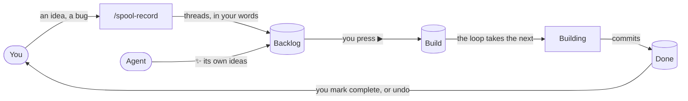

# How Spool works

The [README](../README.md) gets you running in five minutes. This is the long version: what each
piece does, what agents are told, where everything is kept, and every command of the engine.

**A spool 🧶 holds threads 🧵.** Each project's queue of work is its spool, and each piece of work in
it is a thread. The commands agents type call a thread a task: `spool task`.



## A thread's life

| Where it is | What it means | Who moves it on |
| --- | --- | --- |
| 🟠 **Backlog** (proposed) | Filed, sized, explained. Not being built. | **You**: ▶, a drag, a sprint played, or "build that". |
| 🟢 **Build** | You picked it. It is built in its turn. | The loop claims the next one. |
| 🔵 **Building** | An agent has it. | The agent, when it finishes or needs you. |
| ✅ **Done** | Shipped, in commits that carry its id. | **You**: mark it complete, reply, or undo it. |
| ✓ **Complete** | You looked and approved. Kept as history. | Nobody. |

Three things can sit on a thread while it waits:

- **🔴 Needs you.** An agent asked a question only you can answer. That thread stops; the others
  do not.
- **⚪ On hold.** You said not yet. It keeps its place and asks nothing of you.
- **✨ AI suggested.** An agent thought of it. It is in the backlog like anything else, and says
  where it came from.

## The gate

Where the gate is on (`/spool-init` turns it on), every new thread starts in the backlog and **no
agent can claim it**. `spool build`, the human's command, is the only way into Build; the page's ▶,
a drag, and ▶ on a sprint all run it.

A project can also **lock** the gate: `spool init --lock`. Then the three commands that start work —
`build`, `play`, `release` — run only for a person: from a real terminal, or from the page on a
click. An agent that tries is refused and told to hand you the thread's link. Unlocked, an agent
passes your word on when you say "build that" in a chat.

Be clear about what the lock is. It stops an agent starting work by mistake, or on its own reading
of what you meant. It is not a security boundary: a program running as you can do what you can.

## The four skills

You use Spool by talking to your agent. The skills are plain [Agent Skills](https://agentskills.io)
in [`skills/`](../skills): read them, edit them. `spool install` copies them to `~/.claude/skills`;
a copy you have edited is kept when you upgrade. `spool install --for codex` puts the same copies in
`~/.codex/skills`, and `--for cursor` in `~/.cursor/skills`, on the same terms. Gemini CLI, and any
other agent, gets the rules from the Spool block in `AGENTS.md` and from `spool prime`.

**`/spool-init [folder]`** sets a project up: creates `.spool/`, works out the project's name and
one-line description from its README, turns the gate on, and tells you what agents may decide by
themselves (the policy, below). Run where Spool is already set up, it changes nothing.

**`/spool-page`** opens the board and starts the loop. This is the one you use most.

**`/spool-loop`** is the loop without the board: it shows the spool as a table in the chat, builds
what is in Build, and watches for more.

**`/spool-record <what you want, and where>`** files one message. Your words are captured exactly,
split into threads, each given a size and a short spec (what, why, done when), and put in the
backlog. The chat carries on as it was. Only ideas, wishes, feedback and bugs become threads: telling
an agent how to work ("keep going until midnight"), or saying go or no, is acted on, not recorded.

## The page

`spool page` starts a small server on your machine and opens a board. It has three views.

**Board.** Four columns: Backlog, Build, Building, Done.

When anything has shipped that you have not looked at, or anything needs you, a panel sits above
the columns: the morning brief, as `spool brief` gives it, titled with its headline ("4 threads
shipped since you last looked · 2 need you"). Under it: what needs you (a question with its answer
buttons, a plan, a thread that was stopped and what its agent last said), the few threads worth a
look and why, and the rest by sprint, folded shut. Each line opens its thread. **All good: approve
everything** approves every finished thread and every call an agent made; a new skill is still
kept or dropped on its thread. Click the headline to fold the panel to that one line; it stays folded until another thread
finishes. With nothing shipped and nothing needing you, the panel is not there.

- **▶ Build** on a card, or a drag into Build, moves it there. **Not yet** moves it back.
- A move between Backlog and Build, or an archive, can be taken back: its toast has **Undo** for
  about five seconds, longer while the pointer is on it.
- **+ Add** at the foot of Backlog or Build adds a thread to that column.
- **Add to Build** at the foot of the backlog moves everything the backlog is *showing*, after
  every filter, and asks once first.
- Each column has its own **Sort** and **Show**; a **search** (press `/`) and a pill for each
  sprint narrow the whole board.
- Done shows what is still for you to check. **✓** approves one; **Mark all as complete** approves
  the rest; completed threads are kept behind a **History** line.
- The keyboard: `j` and `k` move down and up a column (or the Backlog view's rows), `h` and `l`
  between columns, `Enter` opens the thread, `b` moves it to Build and `x` archives it (both from
  the backlog only), `Esc` closes or lets go, `g b`, `g l` and `g r` switch views, `?` lists the keys.
- `c`, from anywhere on the page, opens one box: type, press `Enter`, and it is in the backlog.
  A `#word` in it is a tag and `!0` to `!3` its priority (`spool task -p`, `--tag`), left out of
  its name; every word is kept on the thread.
- `Cmd+K` (`Ctrl+K` off a Mac) is a palette: type part of a thread's name, its id or a `#tag` to
  open it (archived ones too), or the name of an action: go to a view, switch who builds or the
  agents, play a sprint, add a thread, show the keys. `Up` and `Down` choose, `Enter` runs it, and `Shift+Enter` on a thread copies its id.

**Backlog.** For planning: sprints stacked above the backlog. Create a sprint, drag threads into it,
press **▶ Play sprint**. Notes nobody filed sit in a strip at the top (**Make it a thread**, or
**Set aside**), with anything waiting on you that is about no thread. The strip is gone when it is
empty.

**Roadmap.** Where the work is going, in one row. At the top, the project's goals in a line or
two (where none are set, how to set them). Then the sprints in order: the ones reached, quiet, with
the version each became, the day and how many threads; the one being played, open, with your words
for it, its goal, why, done-when and the goal it serves, how far along it is, and each of its
threads in a line with its state (done, building, in build, in the backlog, or needing you); then
the ones planned, with their goal, how many threads and of what sizes, and **▶ Play sprint**; and
last, how many threads are in no sprint, which opens the Backlog view. A thread's line opens its
ticket. Drag it onto another sprint to move it there, or onto **In no sprint** to take it out. On a
phone the sprints are a stack.

**What waits on you is on its thread.** A question is answered on its card, or on its ticket with a
button or in your own words. A call an agent made by itself is a post in its thread, "Decided: …"
with the question and the why: **Fine**, or overrule it in a sentence and the rework is filed. A card
with calls or a new skill you have not looked at says how many. A plan wanting a go-ahead says so
on its card and gets it on its ticket; a new skill is kept or dropped on the thread that taught it.

**A ticket.** Click any card. On the left, the thread as a conversation: what you said, what the
agent answered and which agent it was, the moves in between, and a box to reply. An audit's or a
plan's report is there in full. What agents write shows as it was meant: code, lists, bold, and links to
the web, which open in a new tab. On the right, its fields: status, priority, difficulty, tags,
version, sprint. Everything is editable. A finished ticket shows **what changed** (the files, the lines, the patch)
and ends with **Mark as complete** and **Undo this thread**, which takes back exactly that thread's
commits with your reason. While the page's own agent builds a thread, its card says the model and
effort it was started with, and its ticket names the agent's session with a button that copies
`claude --resume <session>`, to open it in a terminal. A ticket has its own address (`#t-4kq7`): the link icon beside its id
copies it, and a click on a thread's id, on a card, a row or a ticket, copies the id. And
`?view=backlog` opens the Backlog view, `?view=roadmap` the Roadmap.

**In a background tab.** The tab's title and icon say what is going on: a count, `(2) skyhop`, of
the threads waiting on you (a question, a plan wanting a go-ahead, finished work not yet marked
complete, an agent that stopped and wants a word), and a dot, `● skyhop`, while agents build. With
nothing going on, the title is the project's name.

**Light or dark.** The page follows your system's setting. The round button at the right of the
bar goes from System to Light to Dark and back; your pick is kept in that browser.

**On a phone.** The bar is two rows, the board is one column at a time (swipe sideways, or tap a
column's name in the row above it), and a ticket fills the screen with its fields under the
conversation.

Everything the page does is an ordinary command run as you: `build`, `propose`, `play`, `capture`,
`task`, `edit`, `answer`, `approve`. It can do nothing the command line cannot.

## The loop

Every time it runs, the loop does three things:

1. **Shows the spool**: `spool overview --table` prints every open thread, numbered, under the
   plan it serves: the sprint being played first, with its goal and how far along it is, then the
   planned sprints in the order they were made, then the loose threads in no sprint. A number is
   the thread's place in line, so it means the same thread here and on the page, and a group's
   numbers can skip.
2. **Builds what is in Build.** For each: a line saying what it is starting and its plan, the
   work in small commits, then `spool done` with what changed and two or three steps you can follow
   in a minute to see it working. In a chat that can start subagents, where the project is a git
   repository, it builds as many at once as `spool builder` says (three unless set): each thread
   claimed with `--worktree` and given to a fresh subagent, which works only in that worktree and
   lands it with its own `spool done`, while the chat says a line as each starts and lands and
   answers you. Otherwise one at a time. See
   "Several at once", below.
3. **Says when it is done**, or when something needs you.

**It reacts; it does not wait on a clock.** `spool watch` stays up and prints a line when a thread
can be built, when you reply on one, or when a note stays unfiled for a few seconds. In Claude Code the loop listens to that
with the Monitor tool, so pressing ▶ starts the build within seconds. Where a harness cannot listen,
`/spool-loop <hours>` sets one recurring check instead.

**Commits carry the thread.** Every commit message ends with a trailer:

    Spool: t-4kq7

That is how `spool revert t-4kq7` finds exactly that thread's work and undoes all of it, and
nothing else. It never touches `.spool/`; if a later change conflicts, nothing is undone at all.

**Agents sign their work**: `--as "Claude Fable 5.2"` on the commands they run, so a ticket says
who built it.

**What shipped gets a version.** At the end of a run that shipped something: a bump in the
project's own version file (minor for something new, patch for fixes; a major is your call), a
`CHANGELOG.md` entry, a commit, and a tag that stays on your machine. Each thread is stamped with
the version it shipped in.

## Done means checked

Name the command that proves a change is sound in your project — the tests, a build:

    spool checks "npm test"

From then on `spool done` runs it before a change can be finished, and a failure refuses the finish
and shows the agent what broke. The thread records the check that passed, and its ticket shows it.
The command is kept on your machine (`~/.config/spool/config.json`), never in the project, because
it is run: a repository must not be able to name a program for Spool to start. An agent may set a
check where there is none, on your word; changing or removing one takes you, at your own terminal.

## Several at once: a worktree per thread

One checkout is one agent's desk. Two agents in it edit each other's files, and each one's check
runs on the other's half-made change. So a thread can be built in a
[git worktree](https://git-scm.com/docs/git-worktree) of its own:

    spool start t-4kq7 --worktree        # or: spool next --claim --worktree

The thread is claimed as ever, and it gets a checkout of the repository at
`.spool/worktrees/t-4kq7`, on a new branch `spool/t-4kq7` cut from where your checkout is. Its brief
tells the agent to work there and nowhere else. A project that is one folder of a larger repository
is worked in the same folder of the worktree. A `node_modules` that git ignores is linked in from
your checkout, not copied, so the check has what it needs; the link is named in
`.git/info/exclude`, so `git add -A` leaves it alone. Started again, a thread goes back into the
worktree it has. Where the project is not a git repository, `--worktree` is refused, and the
thread is not claimed.

`spool done` lands it, in five steps:

1. Work in the worktree that is not committed refuses the finish, file by file: it would be lost.
2. The thread's branch is rebased onto wherever your checkout has got to. A conflict refuses the
   finish, names the files, and leaves the worktree as it was, for the agent to rebase and resolve.
3. The project's check runs in the worktree, on the rebased work.
4. Your checkout's branch is fast-forwarded to it. If your own uncommitted changes to the same
   files are in the way, it refuses and says so: they are never run over.
5. The thread is done as ever, and its worktree and branch are removed.

Threads land one at a time, each checked on top of the ones before it. Three built at once arrive
as three sets of commits in a straight line, with no merge commits, and each can still be undone by
itself. One that finishes while another is landing waits its turn; after five minutes it says it is
still waiting, and `spool done` is run again.

Taking a thread back takes its worktree too: `spool propose --abort`, `spool propose --undo` and
`spool drop` remove the worktree and the branch, with any commits that had not landed. Stopping one
(`spool build --abort`) keeps both, and the next start picks up where it was.

The page builds every thread this way, three at a time unless `spool builder --at-once` says
otherwise: see "How many at once", below. A chat running the loop does the same with a subagent
for each thread.

`spool` run inside a worktree acts on the project's one queue. Where `.spool/` is kept in git, a
worktree carries a copy of it, and that copy is never read or written.

Without `--worktree` nothing changes: a thread is built in your checkout, one at a time.

## When an agent reaches a choice

It does one of two things, and the policy decides which.

- **It makes the call and leaves a receipt**: `spool assume`. For anything one undo takes back.
  You see every receipt, and can overrule one in a sentence: the rework is filed for you.
- **It asks**: `spool ask`, with real options, a recommendation and the reason. That thread waits;
  the agent takes the next. On the page, a question is answered with one button.

`.spool/policy.md` is the line between the two, in plain words, and it is yours to edit: what
agents may decide alone, what they must ask about, and what they never do (answer their own
question, approve their own work, push or release without your word).

## Size, kind and order

**Size** is how much would have to change: `xs` a line or a value · `s` one function or screen ·
`m` several files · `l` cuts across the project · `xl` a project in itself. The page calls them
Tiny, Small, Medium, Large, Huge.

**Kind** is what finishing produces:

| Kind | It ends in | Example |
| --- | --- | --- |
| change | commits | "the jump feels floaty" |
| audit | a report, and each finding as a thread | "play it as a new player and tell me what would make them quit" |
| plan | a plan, and its parts as threads | "we need multiplayer" |

Anything sized `xl` is a plan: nothing that big is built in one go.

**Order.** Within Build: first what you put in its place, by dragging a card up or down on the page
or with `spool order`, top first. Then the rest: the most urgent first (Urgent, High, Normal,
Someday), then the smallest, with one pick in four kept for large work so quick wins never starve
it. Among threads of the same urgency and the same turn, a sprint you pressed play on goes before
everything else. A thread that leaves Build, taken by an agent or sent back to the backlog, loses its place.

## Sprints

A sprint is a named set of threads with **no dates**: agents work in hours, so a sprint is over
when its threads are done, not when a fortnight is. It says what it is for: a goal, the reason, and
when it is done, written by you on the page or drafted by an agent. Being in a sprint starts
nothing. Playing it moves everything in it to Build at once. `spool done` says when a sprint's last thread has shipped.
A sprint reached is a version: the agent cuts it then, the changelog entry led by the sprint's name
and goal and listing its threads, and the sprint keeps the version it became, on its line. Work
that ships in no sprint is versioned at the end of a run, as before.

Say what you want a stretch of work to achieve, in your own words, and the agent makes it a
sprint: your words kept on it as its vision, a goal, a reason and a done-when written from them,
and the threads that get there put in it in the order they should be built. It shows you the
sprint in a few lines. You press play, or say "play it"; it never plays one for you. What you
record later goes into the sprint it serves: the one being played, else a planned one, else it
stays loose, and the recorder says where each thread went.

Above the sprints are the **goals**: one short page, `.spool/goals.md`, on what the project is for
and the two or three things it is heading towards. The agent asks you for it at set-up and keeps
it true with you (`spool goals`). Every agent reads it before it works, the loop's list leads with
it, and each sprint says which goal it serves, on its line; `spool check` names one that does not.

## Skills that compound

When an agent works out a multi-step procedure it will need again — shipping a beta, regenerating
assets — it writes it down: `spool skill add`. The skill is a plain file your harness loads, and
Spool keeps the ledger: which thread taught it, who wrote it, how often it is used.

Spool also watches for the ones nobody wrote down. `spool skills --suggest` lists steps that recur
across finished threads with no skill for them, and the loop offers writing them down as an
AI-suggested thread. It matches words, not meaning.

## What is on disk

```
.spool/
  config.json    the project's name, a line on what it is, and the gate
  policy.md      what agents may decide alone; yours to edit
  goals.md       where the project is going, in a few lines; agents read it first
  items/         one markdown file per thread, question, note, sprint and skill record
  reports/       what audits and plans handed in
  worktrees/     a git worktree for each thread being built in one of its own; never in git
```

A thread is a file a person can read:

```markdown
---
id: t-4kq7
kind: task
title: Tighter jump
status: done
priority: 1
size: s
by: Claude Fable 5.2
from: [n-8w2c]
summary: The jump hangs for less time at the top. Try the first level.
commits: [d9ae2d1]
---

> the jump feels floaty, I keep overshooting the small platforms
> — [[n-8w2c]], 2026-11-15

## Log
- 2026-11-15 23:06Z human: moved to build
- 2026-11-15 23:06Z Claude Fable 5.2: started
- 2026-11-15 23:09Z Claude Fable 5.2: done: The jump hangs for less time at the top.
```

Ids are random, so two agents or two branches never collide. "Blocked" is never stored: it is
worked out from what a thread needs every time, so answering a question frees everything behind it
at once. Writes are atomic and locked, so several agents and the page can share one spool.

**Private by default.** Git ignores `.spool/`: it is working state, and it holds your words exactly
as you said them. `spool init --refresh --share` keeps it in git instead, for a team or for its
history.

**A folder of projects.** Set Spool up in a folder that holds several projects and each keeps its
own spool; from the top you see and record into all of them, and from inside one you see just that
one.

## Other ways to run it

**No chat at all, from the page.** `spool page --run`, or the **Agents** switch on the page, has the
page build what is in Build: it starts your agent command on a thread the moment it lands there,
and shows what the agent prints on the card and in the ticket. A thread the agent finishes is done;
one it asks a question on waits for you; one it walks away from is put back and not tried again
until something about it changes. The page says what the agent last said, which is usually why. Use
the page's runner or a chat's loop, not both: they would race each other for the same threads.

**Stop.** A card being built has a **■ Stop**. It ends that thread's agent at once, with anything
the agent started, and one that does not listen is killed two seconds later; agents on other
threads work on, and the Agents switch stays on. The thread goes back to Build with its work kept,
and its card says **Stopped**. Nothing builds a stopped thread: not a note on it, not a change to
it, not the page restarting. **▶ Carry on**, on the card, builds it next, as dragging it into
Building does; so does moving it out of Build and in again. Dragging a card from Building to Build
is the same stop. **↩ Abort** goes further: back to the backlog, with what the agent changed
undone.

**How many at once.** Three, unless you say otherwise: the page gives each thread it builds a git
worktree of its own, as `spool start --worktree` does (see "Several at once"), so no two agents
edit one folder. Its agent is started there, its card and ticket say which folder, and its own
`spool done` lands the work on your branch. `spool builder --at-once 5`, kept as `"parallel": 5` in
`~/.config/spool/config.json`, sets the number; 1 builds one at a time, still in a worktree. Each
card shows its own agent and the Agents switch says how many; the rest of Build waits for one to
finish, and a thread dragged into Building goes to the front. It is read fresh, so no restart is
needed. A project that cannot have worktrees, because it is not a git repository or nothing of it
is committed yet, is built in its own folder, one thread at a time whatever the number says, and
each thread's log says so once. A thread whose worktree cannot be made says why on its log and
waits in Build until something about it changes.

What becomes of the worktree: **Stop** keeps it, with everything in it, and **Carry on** starts the
agent in it again; so does an agent that walks away, and a page that is stopped. **Abort** removes
it and its branch, with every commit made there: none of it had landed, so your checkout is as it
was, and the outcome says so. Done lands it and removes it. A landing that is refused (a conflict,
a failing check, your own uncommitted changes in the way) lands nothing and keeps the worktree, for
the agent to fix and run `spool done` again.

**Which of the two, picked on the page.** Left of the Agents switch are two picks. **Headless** is
the page's own runner, as above. **Chat** is a Claude Code chat running the loop: the page then
starts no agent, whether its runner is on or not, and a thread dragged into Building waits in Build
for the chat. An agent the page had already started is left to finish its thread. With Chat picked
the Agents switch is not a switch but a reading: **building** while a thread is being built,
**watching** while a `spool watch` is up for the project (it leaves a file named with its pid in
the temp folder for as long as it runs), and **off** when nobody is listening, so nothing in Build
would be built. The pick is kept on your machine, by the project's folder, under `builder` in
`~/.config/spool/config.json`, so it outlives the page. It can be set from a chat too, on the human's
word: `spool builder chat` or `spool builder headless` (and `--at-once <n>`, how many threads are
built at the same time, kept as `parallel`). It writes what the page reads, so the page's selector
follows within a second. With nothing after it, `spool builder` says what is set. Setting it is the
human's, refused to an agent where the gate is locked, as `spool build` is.

**In the background.** `spool page -d` starts the page as a process of its own and returns once it
is listening, with its address. It opens no browser and outlives the terminal or chat that started
it; what it prints goes to a log beside its record. Every page, detached or not, leaves a small
record of where it is under `~/.config/spool/pages/`, one per project folder, and removes it when it
stops; a record whose process has died is ignored. So a second start for the same project, with
`-d` or without, gives the address of the one that is up instead of taking the next port, and plain
`spool page` opens that one in the browser. `spool page --status` says where it is, since when,
whether agents are on (it asks the page) and who builds; `spool page --stop` sends it what Ctrl-C
does, so the agent it started is ended and its thread put back, and waits for it to go.

The page keeps itself current. When the code of Spool on disk is no longer the code the page
started from, after an upgrade or a rebuild, it starts nothing new, lets the agents at work finish,
then restarts onto it, at the same address, and the page you have open reloads itself. Its
worktrees are never part of a rebuild: the build reads `src/` alone. Where the project is
Spool's own checkout, the page also runs `npm run build` there each time Build and Building have
both emptied, and never while a thread is being built, so finished work on Spool shows on the page
with no step of yours. A rebuild that fails changes nothing, and the page says why. A page whose
server has gone says so in a line under the bar, with how long ago it last heard from it, and dims
the board; it keeps trying, and the moment `spool page` answers at that address again the line goes,
with nothing reloaded.

**No chat at all, from a terminal.** `spool loop` is a runner of its own: it claims the next thread in Build, starts
your agent command in that project with the rules and the brief on stdin, and looks again when it
exits. `spool loop --watch 5` keeps looking. The agent command comes from your own machine
(`SPOOL_AGENT`, or `agent` in `~/.config/spool/config.json`); the default is `claude -p`.

**Which model, and how hard it thinks.** Where your agent is `claude`, each thread is first passed
to Fable (`claude -p --model fable --effort high`), which reads its brief and decides which model
works it and at what effort, told to lean bigger and heavier than the thread seems to need; it may
take the thread itself. Its choice and its reason go on the thread's log, and the run uses it.
Your own pick always wins: the **Model** and **Effort** fields on the ticket (left unset, they
say Fable decides, and what the size would give), or
`spool edit <id> --model opus --effort high` (`none` hands either back). Where Fable cannot
answer, the size decides, on the big side: a tiny thread gets Sonnet at medium, a small one Opus at
high, a medium one Opus at xhigh, a large one Fable at high, and a huge one Fable at xhigh. A
`claude` command gets `--model` and `--effort` added where it does not set them itself; any other
agent command can take `{model}` and `{effort}` where it wants them, and gets the size's pick.
In `~/.config/spool/config.json`, `"router": false` skips Fable and goes by the table, `"router":
"opus"` asks another model; change the table under `models`, as
`{ "xs": { "model": "sonnet", "effort": "low" } }`, or set `"models": false` to leave the command
alone altogether. `spool loop --dry-run` shows the command each thread would get.

**An agent with no shell.** `spool mcp -C <project>` serves the same commands as
[Model Context Protocol](https://modelcontextprotocol.io) tools over stdio. The set-up commands are
left out, and where the gate is locked the tools that start work are refused there too.

**Notifications outside a chat.** Put a command under `notify` in `~/.config/spool/config.json` and
Spool runs it when an agent asks you something. The details arrive in `SPOOL_EVENT`, `SPOOL_TITLE`,
`SPOOL_ID` and `SPOOL_PROJECT`.

## What Spool will not do

- **Run a repository's code.** `.spool/config.json` is data. The only programs Spool starts, an
  agent and a notifier, come from your own machine's settings, never from the repo you cloned.
- **Leave your machine.** The page listens on `127.0.0.1` only. Changing anything needs the token
  it hands its own page, and a request that names this machine.
- **Decide what gets built.** That is the gate.

## Every command

People rarely type these; the skills do. `spool help <command>` has the details, and every command
takes `--json`, `-C <dir>` and `--as <name>`.

**Yours** — run by an agent only on your word, and where the gate is locked, not at all for the
ones marked 🔒:

| Command | What it does |
| --- | --- |
| `spool build <t-id…>` 🔒 | Move work to Build |
| `spool play <sprint>` 🔒 | Start a sprint: everything in it moves to Build |
| `spool release <t-id…>` 🔒 | Take work off hold |
| `spool propose <t-id…>` | Take work out of Build, back to the backlog |
| `spool order <t-id> --first \| --last \| --before <t-id> \| --after <t-id>` | Say where work in Build is in line: the top is built next |
| `spool archive <t-id…> [--undo]` | Put backlog work out of sight, not dropped: off the board, the lists and the counts, never built. `--undo`, or moving it to Build, brings it back as it was |
| `spool capture <words>` | Drop feedback in, exactly as said |
| `spool answer <d-id> <choice>` | Answer a question, or overrule a call an agent made |
| `spool approve <id…>` | Accept a call, finished work or a new skill; give a plan its go-ahead |
| `spool revert <t-id> [-m why]` | Undo a thread's commits and reopen it with your reason. The reason is kept as a lesson every agent reads first |
| `spool goals [--edit -]` | Where the project is going: what it is for and the two or three things it is heading towards, as every agent reads it first (kept in `.spool/goals.md`); `--edit` replaces it |
| `spool lessons [--drop <n>]` | What you undid and why, newest first, as agents read it (kept in `.spool/policy.md`, yours to edit); `--drop` forgets one |
| `spool review` | Everything waiting on you, most blocking first |
| `spool brief [--since 8h]` | The morning brief: what shipped, what is worth a look and why, what needs you |

**The agents'**:

| Command | What it does |
| --- | --- |
| `spool task` · `audit` · `plan` | File a change, a look-and-report, or something big; `--suggested why` marks an agent's own idea, `--sprint <name>` puts it in a sprint |
| `spool file <n-id> --into <id>` | Attach a note to a thread, or set it aside |
| `spool next [--claim]` · `start <t-id>` | The next thread in Build with its brief; claim it. `--worktree` gives it a git worktree of its own |
| `spool log <id> <fact>` | Leave a note for whoever comes next |
| `spool ask` · `assume` | Put a call to the human; or make it and leave a receipt |
| `spool done <t-id> -m <summary> [--steps <step>…]` | Finish: record the commits, or hand in a report. Work in a worktree of its own is landed first. `--steps` (once a step, or `-` for one a line from stdin) says how to see a change working; a change finished without them says so |
| `spool edit <id>` | Change a title, priority, size, kind, model, effort, tags, version, sprint, or the steps to check it by (`--steps`, `none` clears them); a sprint's version stamps its finished threads too |
| `spool hold <t-id> -m why` · `drop <id>` | Park work; abandon it |
| `spool sprint <name> [--goal …] [--why …] [--done-when …] [--serves <goal>] [--vision - \| --from <n-id>] [--add <t-id…>]` | Make a sprint and fill it in one go, keeping the vision in your words and the goal it serves; on a sprint that exists, add to it |
| `spool skill add` | Write a procedure down as a skill |
| `spool prime [worker\|recorder]` | A role's rules and this project now, for an agent with no skills |

When a new thread's words are close to an open thread, one finished in the last four weeks, or one dropped in the last three months, `spool task` says so after its usual lines and in `--json` as `similar`. It is a nudge: nothing is blocked or merged. Matching is by shared words, so it stays quiet unless most of the words agree.

**Seeing**:

| Command | What it does |
| --- | --- |
| `spool overview [--brief \| --table]` | The whole spool under its colours; `--brief` is a few lines for a chat, `--table` the loop's numbered list. Each thread says why it exists, from the `Why:` line of its spec |
| `spool status` · `list [--archived | --alike]` · `show <id> [--report]` · `inbox` | One screen, with where the board is, who builds, and why Build is not moving when it is not · find items, only the archived threads, or open threads that look like each other (changes nothing) · one item, or the text of its report (over MCP too, for an agent with no shell) · unfiled notes |
| `spool skills [--suggest]` | Every skill; or procedures that keep recurring with no skill |
| `spool graph` · `check` | The items and their links as a diagram; validate the store, and name every open thread with no `Why:` line, and every sprint that serves no goal |

**Set up, and staying up**:

| Command | What it does |
| --- | --- |
| `spool init [folder] [--gate \| --lock] [--share]` | Start a spool; does nothing where one exists |
| `spool demo [folder] [--open]` | A throwaway sample project with threads in its spool, to try the page and the loop on |
| `spool install [--for claude\|codex\|cursor\|gemini\|all] [--here \| --dir path]` | Put the skills where your agent finds them: Claude Code unless `--for` names another; it also names the other agents it finds here |
| `spool checks [command \| --none]` | Name the command that must pass before a change is done here |
| `spool builder [headless \| chat] [--at-once n]` | Say who builds here, and how many threads at once; with nothing after it, says what is set. The human's, like `spool build` |
| `spool agents [on \| off]` | Switch the page's agents on or off, as its Agents button does; with nothing after it, says whether a page is up and its agents are on. On is the human's, like `spool build`, and refused while a chat builds; off is always allowed |
| `spool doctor [--json]` | Check what a run needs and say what is missing, with the line that fixes it; changes nothing |
| `spool page [--run] [--agent cmd] [--port n] [--no-open]` | The board; `--run` has it build what is in Build too |
| `spool page -d \| --status \| --stop` | The board in the background, with no browser opened; whether it is up, and where; end it |
| `spool watch` | Print a line when there is something for the loop to do |
| `spool loop [--watch s] [--agent cmd]` | The runner with no chat |
| `spool mcp [-C dir]` | The commands as MCP tools |

## Develop

```bash
npm install
npm test        # node --test, straight from the TypeScript sources
npm run check   # tsc
```

The tests drive the real CLI in-process against temp directories, including real git repositories
and stand-in agents. One drives the page in the Chrome on your machine, with a real mouse; it is
skipped where there is no Chrome, and `SPOOL_SHOTS=<folder> npm test` keeps a picture of each view.
There are no runtime dependencies.

How to make a change and send it is in [CONTRIBUTING](../CONTRIBUTING.md); where each piece of the
code lives, and how one thread moves through it, is in [a tour of the code](architecture.md).

## Prior art

[OpenSpec](https://github.com/Fission-AI/OpenSpec) showed how well a few agent skills over a small CLI
and plain files work as the interface between people and coding agents, and Spool borrows that shape.
Where spec-first tools begin with a proposal you write before the work, Spool begins with what you say
after using the thing, and optimises the loop that follows: how long agents can keep working before
they need you, and how little of you it takes when they do.

## License

MIT
