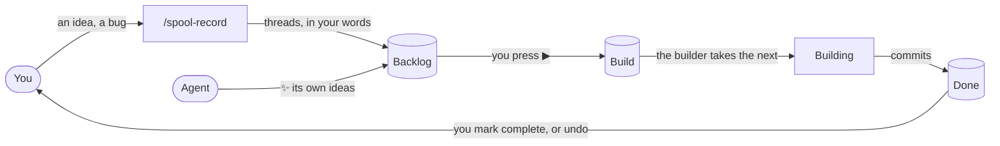

# How Spool works

The [README](../README.md) gets you running in five minutes. This is the long version: what each
piece does, what agents are told, where everything is kept, and every command of the engine.

**A spool 🧶 holds threads 🧵.** Each project's queue of work is its spool, and each piece of work in
it is a thread. The commands agents type call a thread a task: `spool task`.



## A thread's life

| Where it is | What it means | Who moves it on |
| --- | --- | --- |
| 🟠 **Backlog** (proposed) | Filed, sized, explained. Not being built. | **You**: ▶, a drag, a sprint played, or "build that". |
| 🟢 **Build** | You picked it. It is built in its turn. | The builder claims the next one: the page's agents, or a chat running the loop. |
| 🔵 **Building** | An agent has it. | The agent, when it finishes or needs you. |
| ✅ **Done** | Shipped, in commits that carry its id. | **You**: mark it complete, reply, or undo it. |
| ✓ **Complete** | You looked and approved. Kept as history. | Nobody. |

Three things can sit on a thread while it waits:

- **🔴 Needs you.** An agent asked a question only you can answer. That thread stops; the others
  do not.
- **⚪ On hold.** You said not yet. It keeps its place and asks nothing of you.
- **✨ AI suggested.** An agent thought of it. It is in the backlog like anything else, and says
  where it came from.

## The gate

Where the gate is on (`/spool-init` turns it on), every new thread starts in the backlog and **no
agent can claim it**. `spool build`, the human's command, is the only way into Build; the page's ▶,
a drag, and ▶ on a sprint all run it.

A project can also **lock** the gate: `spool init --lock`. Then the three commands that start work —
`build`, `play`, `release` — run only for a person: from a real terminal, or from the page on a
click. An agent that tries is refused and told to hand you the thread's link. Unlocked, an agent
passes your word on when you say "build that" in a chat. `spool leave`, which lets an agent move a
counted few threads to Build for one night (see "The manager"), is locked the same way.

Be clear about what the lock is. It stops an agent starting work by mistake, or on its own reading
of what you meant. It is not a security boundary: a program running as you can do what you can.

## The five skills

You use Spool by talking to your agent. The skills are plain [Agent Skills](https://agentskills.io)
in [`skills/`](../skills): read them, edit them. `spool install` copies them to `~/.claude/skills`;
a copy you have edited is kept when you upgrade. `spool install --for codex` puts the same copies in
`~/.codex/skills`, and `--for cursor` in `~/.cursor/skills`, on the same terms. Gemini CLI, and any
other agent, gets the rules from the Spool block in `AGENTS.md` and from `spool prime`.

How a thread is built is in no skill. It is one file, [`rules/worker.md`](../rules/worker.md), and
`spool prime worker` prints it for whoever builds: a chat running the loop, each subagent it
starts, and the agents the page starts with no chat. They all work by the same words.

**`/spool-init [folder]`** sets a project up: creates `.spool/`, works out the project's name and
one-line description from its README, turns the gate on, and tells you what agents may decide by
themselves (the policy, below). It asks who builds, the board by itself or a chat, and ends with
`spool doctor`. Someone only trying Spool is offered `spool demo` instead. Run where Spool is
already set up, it changes nothing.

**`/spool [what you want]`** steers the spool from a chat. This is the one you use most. It opens
the board ("open the board"), moves threads ("build that one", "not yet", "do the jump first"),
passes on your answers and approvals, catches you up ("what happened overnight"), says why nothing
is building, tidies the backlog, and changes who builds ("switch to chat mode", "turn the agents
off"). It answers in a few lines and leaves the detail on the board. It builds nothing itself.

**`/spool-loop [hours]`** makes that chat the builder. It tells the board that a chat builds here
(`spool builder chat`), builds what is in Build, and then watches for more. `/spool-loop stop` ends
it. See "The loop", below.

**`/spool-lazy`** is lazy dev mode: you look and react, the chat is the 10x dev. It does what the
loop does, but where a worker would ask, it takes the recommended option and leaves a receipt
(`spool assume`); only what the policy says never, or cannot be undone, stops that one thread. It
speaks rarely: a screenshot and a line or two when there is something to see, then it waits. Your
reaction is captured in your words and filed as threads, and the chat keeps what it showed and what
you said. It still builds only what you moved to Build: "do it" about something it showed is a go,
anything else waits proposed. `/spool-lazy off` ends it.

**`/spool-record <what you want, and where>`** files one message. Your words are captured exactly,
split into threads, each given a size and a short spec (what, why, done when), and put in the
backlog, in the sprint it serves if there is one. The chat carries on as it was. Only ideas, wishes,
feedback and bugs become threads: telling an agent how to work ("keep going until midnight") is
acted on, not recorded, and a go, a no or an answer is `/spool`'s.

A skill Spool no longer ships is taken away by the next `spool install`, unless you edited your
copy. `spool doctor` names one that is still there, and a project whose Spool block in `AGENTS.md`
is not the one this version writes: `spool init --refresh` writes it again.

Spool need not be on everywhere. `spool disable` switches it off in a project: the Spool block
comes out of `AGENTS.md` and `CLAUDE.md` (a file that held nothing else goes with it), so no agent
is sent to the queue, and every command there refuses, saying so and how to turn it back on. The
queue is kept as it was, a page already up starts no new work, and the folder above leaves the
project out. `spool enable` puts the block back in the files it came out of. In a folder of
projects, `--all` switches every one of them.

## The page

`spool page` starts a small server on your machine and opens a board. It has three views.

**Board.** Four columns: Backlog, Build, Building, Done.

When anything has shipped that you have not looked at, or a plan or a stopped thread needs you, a
panel sits above the columns: the morning brief, as `spool brief` gives it, titled with its headline
("4 threads shipped since you last looked · 2 need you"). Under it: what needs you (a plan, a thread
that was stopped and what its agent last said), the few threads worth a look and why, and the rest
by sprint, folded shut. A question is counted in the headline but not listed: it is asked on its
thread, and nowhere else. Each line opens its thread. **All good: approve
everything** approves every finished thread and every call an agent made; a new skill is still
kept or dropped on its thread. Click the headline to fold the panel to that one line; it stays folded until another thread
finishes. With nothing shipped and nothing needing you, the panel is not there.

- **▶ Build** on a card, or a drag into Build, moves it there. **Not yet** moves it back.
- A move between Backlog and Build, or an archive, can be taken back: its toast has **Undo** for
  about five seconds, longer while the pointer is on it.
- **+ Add** at the foot of Backlog or Build adds a thread to that column.
- **Add to Build** at the foot of the backlog moves everything the backlog is *showing*, after
  every filter, and asks once first.
- Each column has its own **Sort** and **Show**; a **search** (press `/`) and a pill for each
  sprint narrow the whole board.
- Done shows what is still for you to check. **✓** approves one; **Mark all as complete** approves
  the rest; completed threads are kept behind a **History** line.
- The keyboard: `j` and `k` move down and up a column (or the Backlog view's rows), `h` and `l`
  between columns, `Enter` opens the thread, `b` moves it to Build and `x` archives it (both from
  the backlog only), `Esc` closes or lets go, `g b`, `g l` and `g r` switch views, `?` lists the keys.
- `c`, from anywhere on the page, opens one box: type, press `Enter`, and it is in the backlog.
  A `#word` in it is a tag and `!0` to `!3` its priority (`spool task -p`, `--tag`), left out of
  its name; every word is kept on the thread.
- `Cmd+K` (`Ctrl+K` off a Mac) is a palette: type part of a thread's name, its id or a `#tag` to
  open it (archived ones too), or the name of an action: go to a view, switch who builds or the
  agents, play a sprint, add a thread, show the keys. `Up` and `Down` choose, `Enter` runs it, and `Shift+Enter` on a thread copies its id.

**Backlog.** For planning: sprints stacked above the backlog. Create a sprint, drag threads into it,
press **▶ Play sprint**. Notes nobody filed sit in a strip at the top (**Make it a thread**, or
**Set aside**), with the calls and skills that are about no thread. A question is never there: it is
on its thread. The strip is gone when it is empty.

**Roadmap.** Where the work is going, in one row. At the top, the project's goals under a quiet
**Goals** heading: what it is for, then one line for each thing it is heading towards (where none
are set, how to set them). Then the sprints in order, each saying which goal it serves where it
says so: the ones reached, quiet, with
the version each became, the day and how many threads; the one being played, open, with your words
for it, its goal, why and done-when, how far along it is, and each of its
threads in a line with its state (done, building, in build, in the backlog, or needing you); then
the ones planned, with their goal, how many threads and of what sizes, and **▶ Play sprint**; and
last, how many threads are in no sprint, which opens the Backlog view. A thread's line opens its
ticket. Drag it onto another sprint to move it there, or onto **In no sprint** to take it out. On a
phone the sprints are a stack.

**A sprint's review.** A sprint reached has **Review** on the Roadmap, and the one being played has
**Review so far**. It opens in the Roadmap's place, with a link back: the sprint's name, your words
for it or its goal, and its done-when beside whether every thread is done; a line saying how many
threads, over how long, and how many files they changed; then each thread in a short block, with
what it did in a line, its steps to check as a list you tick as you go (the ticks are yours, kept
in that browser, and approve nothing), the calls its agent made with **Fine** and **Overrule**, and
links to its ticket and its changes. Under them, anything undone or stopped on the way. At the foot,
**Approve the sprint** marks every finished thread in it complete and accepts the calls made on
them, and nothing outside it: `spool approve` with those ids. A sprint with no version yet says
the loop cuts it once the sprint is reached; the page cuts none.

**What waits on you is on its thread.** A question is on its thread and nowhere else on the page:
its card says **Needs a call from you**, and its ticket asks it, answered with a button or in your
own words. A call an agent made by itself is a post in its thread, "Decided: …"
with the question and the why: **Fine**, or overrule it in a sentence and the rework is filed. A card
with calls or a new skill you have not looked at says how many. A plan wanting a go-ahead says so
on its card and gets it on its ticket; a new skill is kept or dropped on the thread that taught it.

**A ticket.** Click any card. On the left, the thread as a conversation: what you said, what the
agent answered and which agent it was, the moves in between, and a box to reply. An audit's or a
plan's report is there in full. What agents write shows as it was meant: code, lists, bold, and links to
the web, which open in a new tab. On the right, its fields: status, priority, difficulty, tags,
version, sprint. Everything is editable. A finished ticket shows **what changed** (the files, the lines, the patch)
and ends with **Mark as complete** and **Undo this thread**, which takes back exactly that thread's
commits with your reason. While the page's own agent builds a thread, its card says the model and
effort it was started with, and its ticket names the agent's session with a button that copies
`claude --resume <session>`, to open it in a terminal. A ticket has its own address (`#t-4kq7`): the link icon beside its id
copies it, and a click on a thread's id, on a card, a row or a ticket, copies the id. And
`?view=backlog` opens the Backlog view, `?view=roadmap` the Roadmap, and `?review=<r-id>` a sprint's review.

**In a background tab.** The tab's title and icon say what is going on: a count, `(2) skyhop`, of
the threads waiting on you (a question, a plan wanting a go-ahead, an agent that stopped or left
without finishing), each counted once, and a dot, `● skyhop`, while agents build. It is the same
number the brief's "need you" says, and on All projects each project's row and the menu. With
nothing going on, the title is the project's name.

**Light or dark.** The page follows your system's setting. The round button at the right of the
bar goes from System to Light to Dark and back; your pick is kept in that browser.

**On a phone.** The bar is two rows, the board is one column at a time (swipe sideways, or tap a
column's name in the row above it), and a ticket fills the screen with its fields under the
conversation.

Everything the page does is an ordinary command run as you: `build`, `propose`, `play`, `capture`,
`task`, `edit`, `answer`, `approve`. It can do nothing the command line cannot.

## In the terminal

`spool`, typed in a terminal with nothing after it, opens the queue full-screen. It is the page's
board in another shape, for when the terminal is where you are: a client of the page's server,
over the same `127.0.0.1` address the browser uses, so there is still one runner to a project. A
key is one of the page's buttons, sent with the token the page keeps in its record on your machine.

The left side is the queue, top to bottom:

- **Needs you**: each open question, each plan waiting for your go-ahead, and each thread in Build
  that you stopped or that its agent left unfinished.
- **Building**: each thread being built, how long it has been, and under it the last thing its
  agent said. On a short screen the last lines go first, so every thread stays in sight.
- **Build**: what waits, numbered in the order it will be built, with the sprint being played
  named beside the count.
- **Done, to check**: finished threads you have not approved, each with what it changed
  (`+38 -12`).
- **Backlog**: a count. Enter opens it to a list: threads in no sprint, then each sprint with what
  waits in it.

The right side is whatever the cursor is on. A thread that is not being built is there to read:
its why, what it waits on, its result and the steps to check it, and what its agent last said. A
question shows its options, a sprint its goal. The top line says whether agents are on, how many
threads are being built, how many things need you, and where the page is.

On a thread being built, the right side is its agent's session, live. Its heading says what the
agent was started with (the model and effort), how long it has been at it, the folder it is built
in and its session. Under that is every line it has said, the newest at the foot, and the screen
follows the end as lines arrive. Scroll up and it holds still while the agent goes on; `End`
follows it again. Move to another building thread and its own lines are there at once. The lines
from before you opened the screen come from the run's transcript in `.spool/runs/`, so a session
can be read back to its start. A thread a chat is building has its lines in that chat, and the
screen says so.

| Key | What it does |
| --- | --- |
| `up` `down`, or `j` `k` | Move through the queue |
| `Tab` | Between the queue and what is beside it: there, the arrows scroll it. `Enter` goes in too, and `Esc` comes back |
| `Enter` | On the backlog, open or close its list |
| `PgUp` `PgDn` `Home` `End` | Scroll what is beside the queue, from either side. A session scrolled up holds still; `End` follows it again |
| `b` | Send a backlog thread to Build; on a thread you stopped, or one left unfinished, carry on |
| `p` | Play a sprint: on its row in the open backlog, or on a thread in it |
| `s` | Stop the agent on a thread being built. It waits in Build until you carry on |
| `a` | Approve a finished thread, or give a plan its go-ahead |
| `1` to `9` | Answer a question with that option, on the question or on a thread it holds up |
| `g` | Switch the page's agents on or off |
| `/` | Add a thread: type one line, `Enter` files it in the backlog, `Esc` leaves it |
| `?` | Every key |
| `q`, or `Ctrl-C` | Leave. The page stays up, and its agents carry on |

With no page up for the project, `spool` starts one in the background, as `spool page -d` does,
and says so in the top line. Its agents are off unless you typed `spool --run`, which also
switches them on where a page is already up. Leaving stops nothing: `spool` again finds the same
page, and `spool page --stop` ends it.

When something shipped since you last looked and nothing is being built, it opens on the brief,
the same one `spool brief` prints; Enter goes on to the queue.

It needs a terminal of 80 by 24 or more, and says so in a smaller one. Whatever happens, a quit, a
signal or an error, the terminal is put back as it was. Where there is no terminal, piped or run
by an agent, `spool` alone prints the status as it always did; `spool --plain` prints it anywhere.

## The loop

`/spool-loop` makes a chat the builder: the one that builds what you moved to Build. It does three
things, and nothing else. Questions about the spool, and steering it, are `/spool`.

1. **Builds what is in Build.** For each: a line saying what it is starting, the work in small
   commits, then `spool done` with what changed and two or three steps you can follow in a minute
   to see it working. In a chat that can start subagents, where the project is a git repository,
   it builds as many at once as `spool builder` says (three unless set): each thread claimed with
   `--worktree` and given to a fresh subagent, which works only in that worktree and lands it with
   its own `spool done`, while the chat says a line as each starts and lands and answers you.
   Otherwise one at a time. See "Several at once", below.
2. **Watches the spool** for more, when Build is empty and while its subagents build.
3. **Says when Build is empty**, or when something needs you. First it gives what shipped a
   version, adds up to three ideas of its own, marked AI suggested, and shows the morning brief.

**It works up to your usage target,** where you set one in the board's header (`spool target`).
Before it claims each thread it reads your plan's weekly and 5-hour usage with its own tool and
reports it with `spool usage`, which says keep building or stop. Stopped, it claims nothing new and
lets what is being built land. With no target it builds what is in Build, whatever the usage.

**It can take over the backlog,** where you switch that on (`spool takeover on`, or Take over in
the header). With Build empty and the usage under the target, it runs `spool build --takeover`,
which moves the top thread you filed to Build, signed by the chat and saying so on the thread, and
builds it. The command picks the thread and checks the usage, so the chat cannot stretch the rule:
nothing AI suggested, on hold or waiting on anything, one at a time, and nothing once the target is
reached. Switched off, nothing moves to Build without you. Where the gate is locked only you can
switch it on.

**It reacts; it does not wait on a clock.** `spool watch` stays up and prints a line when a thread
can be built, when you reply on one, when an agent asks you something, or when a note stays unfiled for a few seconds. In Claude Code the loop listens to that
with the Monitor tool, so pressing ▶ starts the build within seconds. Where a harness cannot listen,
it sets one recurring check instead, every three hours, or `/spool-loop <hours>`.

**The whole list** is `spool overview --table`, which `/spool` shows when you ask for everything:
every open thread, numbered, under the plan it serves. The sprint being played comes first, with
its goal and how far along it is, then the planned sprints in the order they were made, then the
loose threads in no sprint. A number is the thread's place in line, so it means the same thread
there and on the page, and a group's numbers can skip.

**Commits carry the thread.** Every commit message ends with a trailer:

    Spool: t-4kq7

That is how `spool revert t-4kq7` finds exactly that thread's work and undoes all of it, and
nothing else. It never touches `.spool/`; if a later change conflicts, nothing is undone at all.

**Work on no thread is named.** A commit with no `Spool:` trailer, listed by no thread, has
nothing to undo it by or say why it is there. `spool status`, the brief and `spool doctor` name the
newest few, with a count for the rest, and `spool adopt <sha> --for <t-id>` puts one on the thread
it belongs to. They look no further back than the oldest commit already on a thread. A version
commit is on no thread by design: it ends with `Spool-Version: <x.y.z>`, and one titled
`Version x.y.z` without it is taken as one too. Files in the project folder that git does not
know about, and does not ignore, are named the same way; the folders an agent harness or an editor
keeps its own settings in (`.claude/`, `.codex/`, `.cursor/`, `.vscode/` and the like) are left out.

**Agents sign their work**: `--as "Claude Fable 5.2"` on the commands they run, so a ticket says
who built it.

**What shipped gets a version.** At the end of a run that shipped something: a bump in the
project's own version file (minor for something new, patch for fixes; a major is your call), a
`CHANGELOG.md` entry, a commit, and a tag that stays on your machine. Each thread is stamped with
the version it shipped in.

## Done means checked

Name the command that proves a change is sound in your project — the tests, a build:

    spool checks "npm test"

From then on `spool done` runs it before a change can be finished, and a failure refuses the finish
and shows the agent what broke. The thread records the check that passed, and its ticket shows it.
The command is kept on your machine (`~/.config/spool/config.json`), never in the project, because
it is run: a repository must not be able to name a program for Spool to start. An agent may set a
check where there is none, on your word; changing or removing one takes you, at your own terminal.

## Several at once: a worktree per thread

One checkout is one agent's desk. Two agents in it edit each other's files, and each one's check
runs on the other's half-made change. So a thread can be built in a
[git worktree](https://git-scm.com/docs/git-worktree) of its own:

    spool start t-4kq7 --worktree        # or: spool next --claim --worktree

The thread is claimed as ever, and it gets a checkout of the repository at
`.spool/worktrees/t-4kq7`, on a new branch `spool/t-4kq7` cut from where your checkout is. Its brief
tells the agent to work there and nowhere else. A project that is one folder of a larger repository
is worked in the same folder of the worktree. A `node_modules` that git ignores is linked in from
your checkout, not copied, so the check has what it needs; the link is named in
`.git/info/exclude`, so `git add -A` leaves it alone. Started again, a thread goes back into the
worktree it has. Where the project is not a git repository, `--worktree` is refused, and the
thread is not claimed.

`spool done` lands it, in five steps:

1. Work in the worktree that is not committed refuses the finish, file by file: it would be lost.
2. The thread's branch is rebased onto wherever your checkout has got to. A conflict refuses the
   finish, names the files, and leaves the worktree as it was, for the agent to rebase and resolve.
3. The project's check runs in the worktree, on the rebased work.
4. Your checkout's branch is fast-forwarded to it. If your own uncommitted changes to the same
   files are in the way, it refuses and says so: they are never run over.
5. The thread is done as ever, and its worktree and branch are removed.

Threads land one at a time, each checked on top of the ones before it. Three built at once arrive
as three sets of commits in a straight line, with no merge commits, and each can still be undone by
itself. One that finishes while another is landing waits its turn; after five minutes it says it is
still waiting, and `spool done` is run again.

Taking a thread back takes its worktree too: `spool propose --abort`, `spool propose --undo` and
`spool drop` remove the worktree and the branch, with any commits that had not landed. Stopping one
(`spool build --abort`) keeps both, and the next start picks up where it was.

The page builds every thread this way, three at a time unless `spool builder --at-once` says
otherwise: see "How many at once", below. A chat running the loop does the same with a subagent
for each thread.

`spool` run inside a worktree acts on the project's one queue. Where `.spool/` is kept in git, a
worktree carries a copy of it, and that copy is never read or written.

Without `--worktree` nothing changes: a thread is built in your checkout, one at a time.

## When an agent reaches a choice

It does one of two things, and the policy decides which.

- **It makes the call and leaves a receipt**: `spool assume`. For anything one undo takes back.
  You see every receipt, and can overrule one in a sentence: the rework is filed for you.
- **It asks**: `spool ask`, with real options, a recommendation and the reason. That thread waits;
  the agent takes the next. On the page, a question is answered on its thread with one button.
- **In Chat mode the chat asks you.** The chat that builds hears of the question at once, sends you
  a Claude notification that something needs you, and asks it in the chat: its options as buttons,
  the recommended one first, or mockups side by side when it is about how something looks. Your
  pick is the answer, kept on the thread, and the thread is built again. Where the chat has no such
  tools, the question waits on its thread as before.

`.spool/policy.md` is the line between the two, in plain words, and it is yours to edit: what
agents may decide alone, what they must ask about, and what they never do (answer their own
question, approve their own work, push or release without your word).

## Size, kind and order

**Size** is how much would have to change: `xs` a line or a value · `s` one function or screen ·
`m` several files · `l` cuts across the project · `xl` a project in itself. The page calls them
Tiny, Small, Medium, Large, Huge.

**Kind** is what finishing produces:

| Kind | It ends in | Example |
| --- | --- | --- |
| change | commits | "the jump feels floaty" |
| audit | a report, and each finding as a thread | "play it as a new player and tell me what would make them quit" |
| plan | a plan, and its parts as threads | "we need multiplayer" |

Anything sized `xl` is a plan: nothing that big is built in one go.

**Order.** Within Build: first what you put in its place, by dragging a card up or down on the page
or with `spool order`, top first. Then the rest: the most urgent first (Urgent, High, Normal,
Someday), then the smallest, with one pick in four kept for large work so quick wins never starve
it. Among threads of the same urgency and the same turn, a sprint you pressed play on goes before
everything else. A thread that leaves Build, taken by an agent or sent back to the backlog, loses its place.

## Sprints

A sprint is a named set of threads with **no dates**: agents work in hours, so a sprint is over
when its threads are done, not when a fortnight is. It says what it is for: a goal, the reason, and
when it is done, written by you on the page or drafted by an agent. Being in a sprint starts
nothing. Playing it moves everything in it to Build at once. `spool done` says when a sprint's last thread has shipped.
A sprint reached is a version: the agent cuts it then, the changelog entry led by the sprint's name
and goal and listing its threads, and the sprint keeps the version it became, on its line. Work
that ships in no sprint is versioned at the end of a run, as before.

Say what you want a stretch of work to achieve, in your own words, and the agent makes it a
sprint: your words kept on it as its vision, a goal, a reason and a done-when written from them,
and the threads that get there put in it in the order they should be built. It shows you the
sprint in a few lines. You press play, or say "play it"; it never plays one for you. What you
record later goes into the sprint it serves: the one being played, else a planned one, else it
stays loose, and the recorder says where each thread went.

Above the sprints are the **goals**: one short page, `.spool/goals.md`, on what the project is for
and the two or three things it is heading towards. The agent asks you for it at set-up and keeps
it true with you (`spool goals`). Every agent reads it before it works, the whole list leads with
it, and each sprint says which goal it serves, on its line; `spool check` names one that does not.

## The manager

A backlog goes out of order by itself: threads that shipped under another name, one wish filed
twice, ideas nobody sized, an order nobody set. The manager is an agent that puts it back in order
in one pass, with the commands agents always had. It builds nothing and starts no work, and one
undo takes back everything it did. What it may do, what it only proposes and what it never does are
written once, in `rules/manager.md`, and `spool prime manager` prints them (then the goals and the
policy) for a chat, a subagent or any agent with no chat.

**Spool gathers the facts; the agent judges.** `spool manage --start` opens a run on a thread of
its own ("Tidy the backlog, 2026-11-16": an audit tagged `manage`, signed by whoever runs it and
being worked from the start, since it changes no code and so does not go through Build). It prints
`SPOOL_RUN=<id>` for the agent to set on every command that follows, and then a worksheet, worked
out in plain code, the same way every time:

| Step | What it lists |
| --- | --- |
| 0 · Said no to before | Every dropped thread with its reason, the archive, the lessons, and what became of the ideas the last three runs filed |
| 1 · May have shipped already | For each open thread, the evidence: commits that carry its id, commits since it was filed whose subject says what its title says, finished threads that look like it, changelog entries and test names that match. Evidence, never a verdict |
| 2 · Look alike | Pairs of open threads that share most of their words, with the line that merges them |
| 3 · Gone cold | Proposed, and untouched for 30 days. A run's own hand on a thread does not keep it warm |
| 4 · No size, no Why | Open threads with no size, and with no `Why:` line |
| 5 · Too big | Sized large or huge, and not a plan |
| 6 · The order | The backlog as it ranks now, every priority you set yourself (read from the threads' logs), and Build's line |

It also marks the threads to leave alone (in Build, on hold, put in a sprint by you, or ones you
had a hand on in the last 7 days), and says how many new ideas the run may file: 5, or none while
10 earlier ones still wait for your answer. `--json` gives the same as data. Spool calls no model for any of this. Matching
is by shared words, and words usual across the project's own titles are left out, so sharing
"page" proves nothing.

The agent then sizes, notes, re-orders, drafts sprints and proposes, each command recorded under
the run. `spool manage --end -m "<headline>" --report -` finishes the run's thread with a report:
the headline, whatever the agent has to say (what needs you, and why), then every change the
journal holds, grouped (dropped, sized, re-ordered, marked as plans, sprints drafted, new ideas),
each with its reason where one was given. The report is read on the thread's ticket and with
`spool show <id> --report`, the thread is in `spool brief` like any finished audit, and
`spool revert <id>` takes the whole pass back. `spool manage` alone says whether a run is open.
There is one run at a time in a project, and its thread is never handed to a worker.

**What it would do, for your yes or no.** Where it has no leave to drop or build, the run puts the
change on its thread instead: `spool manage --propose drop <t-id> -m "Shipped in <sha>: …"` (or
`archive`, or `build`). Each is numbered. On the run's ticket, each has a Yes and a No, big enough
for a thumb; a Yes runs that verb as you, with the run's reason, and a No leaves the thread alone.
`spool manage --answer yes 3` (or `no all`) does the same from a chat. The brief has one line for
it, "The manager proposes 12 changes", which opens the run's thread; the proposals are not listed
in the brief, and a question stays on its own thread.

**A leave.** By itself the manager only tidies. How far it may go beyond that is yours to say,
in your own words, for one night at a time:

    spool leave "work through whatever still seems relevant, I'll check in the morning" --until 8am --build 5 --drop-shipped

- `--build <n>`: an agent may move up to n threads to Build, with `spool build <t-id> --leave`.
  Each one is counted, and logged on its thread as "moved to build under the leave: <your words>".
  Once the count is used up, or the time has passed, it is refused, in your words.
- `--drop-shipped`: an agent may drop a thread as shipped, with
  `spool drop <t-id> --leave -m "Shipped in <sha>: …"`, and only when the reason names a commit
  that exists.
- `--proposals <n>`: a run may file up to n new ideas, where it would file five.

With none of them it is a leave to tidy, on record. A leave lifts no hold and brings nothing back
from the archive.

It is kept in `.spool/leave.json`: your words, who gave it, when, until when, what it allows and
how much of that is used. It ends at `--until`, which is 8 the next morning unless you say and
never more than 24 hours away; sooner with `spool leave --end`; and when a run that ran under it
is undone. One that has run out is removed by the first command that finds it, with a line on the
open run's thread. Nothing renews a leave, and a second cannot be given while one is live: the
next night needs a new one. `spool leave` alone says what is live. `spool manage --start` prints
the live leave at the top of the worksheet, and the run's report names it.

Giving a leave is yours, like `spool build`: where the gate is locked an agent is refused, and
unlocked, a chat gives one on your plain word ("manage this until midnight").

## New ideas

Ask for ideas ("come up with ideas for this project") and the chat runs `spool ideate`. Like the
manager, Spool gathers the facts and the agent judges: the worksheet holds the goals, the threads
finished lately and the changelog's newest version, every open thread, your notes, newest first,
what was dropped and why, the lessons, and where the code and its docs are. Then the rules for a
good idea, and how to file one. It writes nothing itself.

Each idea is filed with `spool task "<idea>" --suggested "<why>"`: proposed, marked AI suggested,
with its reason. One that looks like a thread already there is named as it is filed, and dropped.
A pass files five at most, and none while ten earlier AI ideas still wait for an answer;
`--max <n>` is your own number, and it stands. Nothing filed is built until you move it to Build,
and a no is `spool drop` with your reason, which the next pass reads. The loop's own few ideas,
when Build is empty, start from the same worksheet.

## A run, undone in one step

Some work is many small changes to the queue and none to the code: sizing a backlog, dropping what
has shipped, filing a few ideas. Each is easy to take back, and sixty are not. So an agent makes
them under a **run**: it sets `SPOOL_RUN` to the id of the thread the run belongs to, on every
command.

    SPOOL_RUN=t-7k2m spool edit t-4kq7 --size s

Under a run, the first time a command writes an item, its file as it was is copied to
`.spool/runs/t-7k2m/before/` (or a marker is left that the run made it), and every write adds a
line to `.spool/runs/t-7k2m/journal.jsonl`: when, which item, what changed, by which command. The
run's own thread is not recorded.

`spool revert t-7k2m -m "why"` then puts every item back as it was, byte for byte, and removes the
ones the run made. An item changed since the run last wrote it, by you or by anyone, is named and
left as it is. One that someone else wrote between two of the run's writes goes back only as far
as what they left, and is named too: nobody's change is taken back with the run's. No code is
touched: a thread built since the run moved it to Build keeps its
commits, and is listed with its own undo. Your reason is kept as a lesson, as with any undo, and
the run's thread is dropped. None of this leans on git, since in most projects `.spool/` is not in
git.

What is undone is the queue: the items. A skill's own folder is outside it, so where a run wrote
or dropped a skill, the undo puts the skill's record back and says that its files are as the run
left them.

A run is undone once. After that, or once its thread is done, a command that still carries its
`SPOOL_RUN` is refused, so nothing is changed in the belief that it is on record.

## Skills that compound

When an agent works out a multi-step procedure it will need again — shipping a beta, regenerating
assets — it writes it down: `spool skill add`. The skill is a plain file your harness loads, and
Spool keeps the ledger: which thread taught it, who wrote it, how often it is used.

Spool also watches for the ones nobody wrote down. `spool skills --suggest` lists steps that recur
across finished threads with no skill for them, and the loop offers writing them down as an
AI-suggested thread. It matches words, not meaning.

## What is on disk

```
.spool/
  config.json    the project's name, a line on what it is, and the gate
  policy.md      what agents may decide alone; yours to edit
  goals.md       where the project is going, in a few lines; agents read it first
  leave.json     the leave that is live, if you gave one: your words, until when, what it allows
  items/         one markdown file per thread, question, note, sprint and skill record
  reports/       what audits and plans handed in
  runs/          per thread: what its agent printed, its pictures (files/), and for a run, its journal and the copies an undo puts back; never in git
  worktrees/     a git worktree for each thread being built in one of its own; never in git
```

A thread is a file a person can read:

```markdown
---
id: t-4kq7
kind: task
title: Tighter jump
status: done
priority: 1
size: s
by: Claude Fable 5.2
from: [n-8w2c]
summary: The jump hangs for less time at the top. Try the first level.
commits: [d9ae2d1]
---

> the jump feels floaty, I keep overshooting the small platforms
> — [[n-8w2c]], 2026-11-15

## Log
- 2026-11-15 23:06Z human: moved to build
- 2026-11-15 23:06Z Claude Fable 5.2: started
- 2026-11-15 23:09Z Claude Fable 5.2: done: The jump hangs for less time at the top.
```

Ids are random, so two agents or two branches never collide. "Blocked" is never stored: it is
worked out from what a thread needs every time, so answering a question frees everything behind it
at once. Writes are atomic and locked, so several agents and the page can share one spool.

**Private by default.** Git ignores `.spool/`: it is working state, and it holds your words exactly
as you said them. `spool init --refresh --share` keeps it in git instead, for a team or for its
history.

**A folder of projects.** Set Spool up in a folder that holds several projects and each keeps its
own spool; from the top you see and record into all of them, and from inside one you see just that
one. The page is the same: started at the top, it opens on **All projects**, a row for each project
(what is building and its agent's last line, what needs you, what is done to check, the sprint being
played) under the brief across all of them. The project's name in the bar is a menu of every project,
with what each holds and a mark on those that need you; choosing one shows its board in place, and
the address says which (`?project=<name>`, beside `?view=` and `#<thread>`). Every click on a board
is for that project: the page sends its name, the server takes only a name on the workspace's own
list and runs the command in that project's folder, and an id that belongs to another project is
refused. Started at the top, the page's runner builds every project's threads, each in its own
folder and worktrees, with the at-once number shared across them; **Headless** or **Chat** is kept
per project, and a project set to Chat is left to its chat. Started with `-P <project>`, it builds
that one only, and the other boards say their agents are run by their own page or a chat.

## Other ways to run it

**No chat at all, from the page.** `spool page --run`, or the **Agents** switch on the page, has the
page build what is in Build: it starts your agent command on a thread the moment it lands there,
and shows what the agent prints on the card and in the ticket. A thread the agent finishes is done;
one it asks a question on waits for you; one it walks away from is put back and not tried again
until something about it changes. The page says what the agent last said, which is usually why. Use
the page's runner or a chat's loop, not both: they would race each other for the same threads.

**Say something to it while it works.** A `claude -p` agent is started with its input left open,
so it can be spoken to. Reply on the ticket of a thread that is being built and your words reach
its agent within a second, as a message from you; it reads them at its next step and adjusts. They
are kept on the thread first, as any reply is, and the thread's log says they were passed on. The
ticket says **hears your replies** beside the agent where this works. The agent is told as much when it starts: that you
may write to it, and that a question still goes through `spool ask`, since you may not be reading
what it says. When its turn ends it goes, as an agent always did; one that stops with the thread
unfinished just after you wrote to it is kept five minutes for what you say next. Any other agent
command is watched only: your reply waits on the thread for its next run. Either way the ticket
shows **Typing…** the moment you send, until the agent is heard again.

**A reply where nobody is building gets a quick answer.** Write on a thread no agent of the page
is building, and **Typing…** shows at once; within seconds a small model answers on the thread:
Haiku for a one-line message, Sonnet for anything longer, signed with its model. It is given the
thread's brief, its recent log and your words, and answers a question or says your idea or change
was added to the thread. It never builds and never moves the thread. Each is one short call of the
same `claude` your agent command runs, at low effort, able only to read the project (Read, Grep,
Glob), given up after a minute, and no more than three at once; one that fails says so on the
thread. It answers in Chat mode too, and with Agents off, since it builds nothing. Turn it off with
`"quickReply": false` in `~/.config/spool/config.json`. An agent command that is not `claude -p`
gets no quick reply.

**It asks you before a tool it may not use.** A `claude -p` agent can only do what your agent
command allows it. Until now a tool call outside that was refused in silence, and you found out
after the run. Now the call waits, and the question is on the thread's card in Building and on its
ticket: what it wants to run, what the agent said it is for, and three answers. The card says a
long command in short; the ticket shows it whole, as it was written, so read it there. **Allow once**
lets that call through. **Allow for this run** also stops it asking again for the like until this
run ends, by what Claude Code itself suggests for the call (hover the button to read it: a rule
for the command, a folder, or file edits accepted); nothing is written to your settings. **No**
refuses it, and on the ticket you can say why, which the agent is told. The thread's log says who
allowed or refused what. The question waits ten minutes, then is refused. It only waits when
someone is there: if no page has asked for the board in the last 30 seconds, it is refused at
once, as before, so a sprint you walked away from never stops on a question. Your notifier is told
when one waits (`SPOOL_EVENT` is `permission`).

**Stop.** A card being built has a **■ Stop**. It ends that thread's agent at once, with anything
the agent started, and one that does not listen is killed two seconds later; a `claude -p` agent
is asked to stop first, so that its session knows it was stopped, and ended three seconds later if
it is still there. Agents on other
threads work on, and the Agents switch stays on. The thread goes back to Build with its work kept,
and its card says **Stopped**. Nothing builds a stopped thread: not a note on it, not a change to
it, not the page restarting. **▶ Carry on**, on the card, builds it next, as dragging it into
Building does; so does moving it out of Build and in again. Dragging a card from Building to Build
is the same stop. **↩ Abort** goes further: back to the backlog, with what the agent changed
undone.

**Carry on is the same session.** A `claude -p` agent is started in a Claude session the page
chose (`--session-id`), unless your agent command names one itself. When a thread's run ends
unfinished, because you stopped it, the agent walked away, or the page was stopped, the next run
of it picks that session up (`--resume`), in the same folder. The agent is not given the rules and
the brief a second time: it is told how it came to stop, and what you have written on the thread
since. It runs with the model it had, and nobody chooses one again. A thread you moved out of
Build and back, or undid, starts afresh, since what the session remembers may no longer be so. So
does one whose session cannot be picked up, because the agent command is not `claude -p` or Claude
no longer has the session; its log says which. What the page remembers of a session is beside the
thread's transcripts, in `.spool/runs/<id>/session.json`.

**A run that was cut off carries on.** A page that is killed outright, or a machine that goes
down, leaves its threads marked as being built with nobody building them. The next page to start
finds them. With agents on, each that was in a Claude session is carried on there at once, in the
folder it was in, and never leaves Building; its agent is told that Spool was stopped and is back.
Any other is put back in Build as before, and so are all of them where agents are off: those wait
there, and are carried on in their sessions when agents are switched on. Whatever is left of the
agent the dead page had started is ended first. It would otherwise work on to the end of its turn,
and two programs must not be in one session. [docs/claude-stream.md](claude-stream.md)
has what was tried against Claude Code, and on which version.

**A quiet agent.** An agent that has printed nothing for ten minutes shows "Quiet for N min" in red
on its card in Building, and the `stuck` notice goes out once (see `spool notify`). `"quietMinutes"` in
`~/.config/spool/config.json` sets the ten, 0 for never. `"quietStopMinutes"` is off unless set: past it
the page stops the agent and the thread goes back to Build as stopped. An agent waiting on your yes or
on a word is not quiet. In Chat mode the page starts no agents, so this is for Headless.

**How many at once.** Three, unless you say otherwise: the page gives each thread it builds a git
worktree of its own, as `spool start --worktree` does (see "Several at once"), so no two agents
edit one folder. Its agent is started there, its card and ticket say which folder, and its own
`spool done` lands the work on your branch. `spool builder --at-once 5`, kept as `"parallel": 5` in
`~/.config/spool/config.json`, sets the number; 1 builds one at a time, still in a worktree. Each
card shows its own agent and the Agents switch says how many; the rest of Build waits for one to
finish, and a thread dragged into Building goes to the front. It is read fresh, so no restart is
needed. A project that cannot have worktrees, because it is not a git repository or nothing of it
is committed yet, is built in its own folder, one thread at a time whatever the number says, and
each thread's log says so once. A page started at a folder of projects builds them all, and the
number is for the whole page: three at a time across every project, where a project with no git
has one at most, which counts as one of the three. The board of each project, and `spool builder`
in it, says how many at once that project really gets: the number, or 1 where it cannot have
worktrees. A thread whose worktree cannot be made says why on its log and
waits in Build until something about it changes.

What becomes of the worktree: **Stop** keeps it, with everything in it, and **Carry on** starts the
agent in it again; so does an agent that walks away, and a page that is stopped. **Abort** removes
it and its branch, with every commit made there: none of it had landed, so your checkout is as it
was, and the outcome says so. Done lands it and removes it. A landing that is refused (a conflict,
a failing check, your own uncommitted changes in the way) lands nothing and keeps the worktree, for
the agent to fix and run `spool done` again.

**A failed check gets one more go (Headless).** When the check refuses a `spool done` and the
agent stops with the thread unfinished, the runner gives the same Claude session what the check
said (the end of its output) and asks it to fix it and run `spool done` again. It is the same run,
the same model: not a new run for the step-up, and a thread that lands after it did not "not work".
A second failure puts the thread back in Build, with the output on its log. In Chat the page starts
no agent; the loop's subagents already retry by themselves under the worker's rules.

**Which of the two, picked on the page.** Left of the Agents switch are two picks. **Headless** is
the page's own runner, as above. **Chat** is a Claude Code chat running the loop: the page then
starts no agent, whether its runner is on or not, and a thread dragged into Building waits in Build
for the chat. An agent the page had already started is left to finish its thread. With Chat picked
the Agents switch is not a switch but a reading: **building** while a thread is being built,
**watching** while a `spool watch` is up for the project (it leaves a file named with its pid in
the temp folder for as long as it runs), and **off** when nobody is listening, so nothing in Build
would be built. The pick is kept on your machine, by the project's folder, under `builder` in
`~/.config/spool/config.json`, so it outlives the page. It can be set from a chat too, on the human's
word: `spool builder chat` or `spool builder headless` (and `--at-once <n>`, how many threads are
built at the same time, kept as `parallel`). It writes what the page reads, so the page's selector
follows within a second. With nothing after it, `spool builder` says what is set. Setting it is the
human's, refused to an agent where the gate is locked, as `spool build` is.

**In the background.** `spool page -d` starts the page as a process of its own and returns once it
is listening, with its address. It opens no browser and outlives the terminal or chat that started
it; what it prints goes to a log beside its record. Every page, detached or not, leaves a small
record of where it is under `~/.config/spool/pages/`, one per project folder, and removes it when it
stops; a record whose process has died is ignored. So a second start for the same project, with
`-d` or without, gives the address of the one that is up instead of taking the next port, and plain
`spool page` opens that one in the browser. A page started at the top of a folder of projects with
no project named builds every one of them, so its record names each project's folder, kept current
as it reads the folder, and a command inside any of them looks in the folders above it too: there,
`spool status`, `spool agents`, `spool page -d` and `--status` find that page and say where it was
started, and no second page starts beside it. `spool page --status` says where it is, since when,
whether agents are on (it asks the page) and who builds; `spool page --stop` sends it what Ctrl-C
does, so the agent it started is ended and its thread put back, and waits for it to go.

The page keeps itself current. When the code of Spool on disk is no longer the code the page
started from, after an upgrade or a rebuild, it starts nothing new, lets the agents at work finish,
then restarts onto it, at the same address, and the page you have open reloads itself. Its
worktrees are never part of a rebuild: the build reads `src/` alone. Where the project is
Spool's own checkout, the page also runs `npm run build` there each time Build and Building have
both emptied, and never while a thread is being built, so finished work on Spool shows on the page
with no step of yours. A rebuild that fails changes nothing, and the page says why. A page whose
server has gone says so in a line under the bar, with how long ago it last heard from it, and dims
the board; it keeps trying, and the moment `spool page` answers at that address again the line goes,
with nothing reloaded.

**No chat at all, from a terminal.** `spool loop` is a runner of its own: it claims the next thread in Build, starts
your agent command in that project with the rules and the brief on stdin, and looks again when it
exits. `spool loop --watch 5` keeps looking. The agent command comes from your own machine
(`SPOOL_AGENT`, or `agent` in `~/.config/spool/config.json`); the default is `claude -p`.

**Which model, and how hard it thinks.** Each thread is built by the smallest model that can do
work of its size, to spare your plan's usage when several are built at once: a tiny thread by Haiku
at medium effort, a small one by Sonnet at medium, a medium one (or one not sized) by Opus at
medium, a large one by Opus at high, and a huge one by Opus at xhigh. A thread whose last run did
not work is built next by the model one up from the one that ran it (Haiku, Sonnet, Opus, then
Fable), thinking at least as hard: did not work means its work was undone (reverted, or taken back
from Done), or its agent left it without finishing. Stopping it yourself, or a question it asked,
does not count, and a run carried on in its own session keeps the model it had. The step and its
reason go on the thread's log ("stepped up from haiku to sonnet · medium: its last run was
undone"). Your own pick always wins: the **Model** and **Effort** fields on the ticket (left
unset, they say what the size gives, as "Sonnet, by its size", or the step up and why; once a
thread has run, they show the model and effort its agent's command really named, and where it
named none, the boxes are for the next run), or `spool edit <id> --model opus --effort high`
(`none` hands either back). A `claude` command gets `--model` and `--effort` added where it does
not set them itself; any other agent command can take `{model}` and `{effort}` where it wants them.
In Chat mode, `spool start` and `spool next --claim` print the pick on a `MODEL` line under the
brief, and log it on the thread ("builder model: haiku · medium, by its size"): the chat starts
the subagent that builds the thread on it. In `~/.config/spool/config.json`, change the table under
`models`, as `{ "xs": { "model": "sonnet", "effort": "low" } }`, or set `"models": false` to leave
the command alone altogether. `spool loop --dry-run` shows the command each thread would get.

**An agent with no shell.** `spool mcp -C <project>` serves the same commands as
[Model Context Protocol](https://modelcontextprotocol.io) tools over stdio. The set-up commands are
left out, and where the gate is locked the tools that start work are refused there too.

**What notifies you.** The bell on the board, or `spool notify`, picks the events that tell you,
for every project: `started` a thread starts, `done` one is done, `question` a question or a plan
waits on you, `sprint` a sprint is finished, `empty` Build is empty, `stuck` an agent is stuck or
refused, `budget` the usage target stops the run. With nothing picked it is `question`, `empty`,
`stuck` and `budget`. Everything else is quiet. `spool notify on started`, `off done`, `only
started question` and `default` change it; it is kept under `notifyOn` in your own settings. In
Chat mode the chat that builds runs `spool notify check <event>` before each and sends the ones you
picked as one-line Claude notifications.

**Notifications outside a chat.** Put a command under `notify` in `~/.config/spool/config.json` and
Spool runs it for the events you picked. The details arrive in `SPOOL_EVENT`, `SPOOL_TITLE`,
`SPOOL_ID` and `SPOOL_PROJECT`. The event is `ask` for a question, `plan` for a plan that waits
for your go-ahead, `idle` when the loop has nothing left but questions, `permission` when an
agent the page runs needs your yes for a tool call, `started`, `done` and `stuck` for a thread the
page builds, and `sprint` when a sprint is finished.

## What Spool will not do

- **Run a repository's code.** `.spool/config.json` is data. The only programs Spool starts, an
  agent and a notifier, come from your own machine's settings, never from the repo you cloned.
- **Leave your machine.** The page listens on `127.0.0.1` only. Changing anything needs the token
  it hands its own page, and a request that names this machine.
- **Decide what gets built.** That is the gate.

## Every command

People rarely type these; the skills do. `spool help <command>` has the details, and every command
takes `--json`, `-C <dir>` and `--as <name>`. Text is taken as given even where it starts with a dash
(`spool goals --edit "- a goal"`, `spool task "--steps takes several"`); the one word that cannot be
told from an option is one of the command's own, and that goes joined with `=` (`-m` as
`--message="--json"`) or after `--`.

**Yours** — run by an agent only on your word, and where the gate is locked, not at all for the
ones marked 🔒:

| Command | What it does |
| --- | --- |
| `spool build <t-id…> [--leave]` 🔒 | Move work to Build. `--leave` is how an agent moves it there itself under a leave you gave, up to the leave's count |
| `spool leave "<your words>" [--until time] [--build n] [--drop-shipped] [--proposals n]` 🔒 | Say how far agents may go while you are away, and until when (8 the next morning unless said, 24 hours at most). `--end` ends it, and anyone may; with nothing after it, says what is live |
| `spool play <sprint>` 🔒 | Start a sprint: everything in it moves to Build |
| `spool release <t-id…>` 🔒 | Take work off hold |
| `spool propose <t-id…>` | Take work out of Build, back to the backlog |
| `spool order <t-id> --first \| --last \| --before <t-id> \| --after <t-id>` | Say where work in Build is in line: the top is built next |
| `spool archive <t-id…> [--undo]` | Put backlog work out of sight, not dropped: off the board, the lists and the counts, never built. `--undo`, or moving it to Build, brings it back as it was |
| `spool capture <words>` | Drop feedback in, exactly as said |
| `spool answer <d-id> <choice>` | Answer a question, or overrule a call an agent made |
| `spool approve <id…>` | Accept a call, finished work or a new skill; give a plan its go-ahead |
| `spool revert <t-id> [-m why] [--now]` | Undo a thread's commits and put it back in the backlog with your reason, for you to move to Build (`--now`: straight back to Build). The reason is kept as a lesson every agent reads first. Given a run's thread, it puts back every item the run changed and touches no code |
| `spool goals [--edit <text> \| -]` | Where the project is going: what it is for and the two or three things it is heading towards, as every agent reads it first (kept in `.spool/goals.md`); `--edit` replaces it |
| `spool lessons [--drop <n>]` | What you undid and why, newest first, as agents read it (kept in `.spool/policy.md`, yours to edit); `--drop` forgets one |
| `spool review` | Everything waiting on you, most blocking first |
| `spool brief [--since 8h]` | The morning brief: what shipped, what is worth a look and why, what needs you |

**The agents'**:

| Command | What it does |
| --- | --- |
| `spool task` · `audit` · `plan` | File a change, a look-and-report, or something big; `--suggested why` marks an agent's own idea, `--sprint <name>` puts it in a sprint |
| `spool file <n-id> --into <id>` | Attach a note to a thread, or set it aside |
| `spool next [--claim]` · `start <t-id>` | The next thread in Build with its brief; claim it. `--worktree` gives it a git worktree of its own |
| `spool log <id> <fact>` | Leave a note for whoever comes next |
| `spool adopt <sha…> --for <t-id>` | Put a commit that landed on no thread on the thread it belongs to: it joins the thread's commits, so `spool revert` takes it back with the rest, and the thread's log says so. Refused for a commit on a thread already, or not on this branch |
| `spool attach <t-id> <file…> [--as before\|after] [-m caption]` | Keep a picture or a file with a thread: a PNG, JPEG, GIF or WebP picture or a PDF, told by its bytes, or plain text (`.txt .md .csv .json .log`, UTF-8), 5 MB and 20 a thread at most. A file keeps its own name after Spool's number, and text is only ever served as plain text. It is copied into `.spool/runs/<id>/files/` under a name Spool gives, a line on the thread's log says who attached it and the caption, and the thread's brief names its path. `--as before` and `--as after` are the proof of a change you can see, shown side by side when it is done. A picture pasted or dropped into a box on the page, or a file dropped on a thread or picked with Add a file, is attached the same way, and `spool watch` prints a `reply:` line with its path |
| `spool ask` · `assume` | Put a call to the human; or make it and leave a receipt |
| `spool done <t-id> -m <summary> [--steps <step>…]` | Finish: record the commits, or hand in a report. The summary keeps its line breaks, so a list in it stays a list. Work in a worktree of its own is landed first. `--steps` (each word after it is a step, as in `--steps "Open the board" "The card is at the top"`, or `-` for one a line from stdin) says how to see a change working; a change finished without them says so |
| `spool edit <id>` | Change a title, priority, size, kind, model, effort, tags, version, sprint, or the steps to check it by (`--steps`, `none` clears them); a sprint's version stamps its finished threads too |
| `spool hold <t-id> -m why` · `drop <id> [--leave]` | Park work; abandon it. `drop --leave -m "Shipped in <sha>: …"` drops a thread as shipped under a leave that allows it, and the commit must exist |
| `spool sprint <name> [--goal …] [--why …] [--done-when …] [--serves <goal>] [--vision - \| --from <n-id>] [--add <t-id…>]` | Make a sprint and fill it in one go, keeping the vision in your words and the goal it serves; on a sprint that exists, add to it |
| `spool manage [--start \| --end -m headline [--report -]]` | Put the backlog in order as one run that can be undone: `--start` opens the run and prints the worksheet of facts to work from, `--end` writes the report of what it changed; with neither, says whether a run is open |
| `spool skill add` | Write a procedure down as a skill |
| `spool prime [worker\|recorder\|manager] [--context]` | A role's rules and this project now. `worker` prints `rules/worker.md`, which everyone who builds follows; `manager` prints `rules/manager.md`, which whoever tidies the backlog follows; `--context` leaves the rules out |

When a new thread's words are close to an open thread, one finished in the last four weeks, or one dropped in the last three months, `spool task` says so after its usual lines and in `--json` as `similar`. It is a nudge: nothing is blocked or merged. Matching is by shared words, so it stays quiet unless most of the words agree.

**Seeing**:

| Command | What it does |
| --- | --- |
| `spool overview [--brief \| --table]` | The whole spool under its colours; `--brief` is a few lines for a chat, `--table` the numbered list. Each thread says why it exists, from the `Why:` line of its spec |
| `spool status` · `list [--archived | --alike]` · `show <id> [--report]` · `inbox` | One screen, with where the board is, who builds, and why Build is not moving when it is not · find items, only the archived threads, or open threads that look like each other (changes nothing) · one item, or the text of its report (over MCP too, for an agent with no shell) · unfiled notes |
| `spool skills [--suggest]` | Every skill; or procedures that keep recurring with no skill |
| `spool graph` · `check` | The items and their links as a diagram; validate the store, and name every open thread with no `Why:` line, and every sprint that serves no goal |

**Set up, and staying up**:

| Command | What it does |
| --- | --- |
| `spool init [folder] [--gate \| --lock] [--share]` | Start a spool; does nothing where one exists |
| `spool disable [--all]` · `enable [--all]` | Switch Spool off in a project: its block comes out of `AGENTS.md` and `CLAUDE.md`, so no agent is sent to it, and its commands refuse; the queue is kept. On again puts the block back where it was. `--all` does every spool in this folder and below |
| `spool demo [folder] [--open]` | A throwaway sample project with threads in its spool, to try the page and the loop on |
| `spool install [--for claude\|codex\|cursor\|gemini\|all] [--here \| --dir path]` | Put the skills where your agent finds them: Claude Code unless `--for` names another; it also names the other agents it finds here |
| `spool checks [command \| --none]` | Name the command that must pass before a change is done here |
| `spool builder [headless \| chat] [--at-once n]` | Say who builds here, and how many threads at once; with nothing after it, says what is set. The human's, like `spool build` |
| `spool agents [on \| off]` | Switch the page's agents on or off, as its Agents button does; with nothing after it, says whether a page is up and its agents are on. On is the human's, like `spool build`, and refused while a chat builds; off is always allowed |
| `spool doctor [--json]` | Check what a run needs and say what is missing, with the line that fixes it. It names work that landed on no thread, as `spool status` does. After an upgrade it also names a retired skill that is still installed, for any agent, and a Spool block in `AGENTS.md` that is not the one this version writes; changes nothing |
| `spool page [--run] [--agent cmd] [--port n] [--no-open] [-P project]` | The board; `--run` has it build what is in Build too. In a folder of projects it shows them all, one click apart |
| `spool page -d \| --status \| --stop` | The board in the background, with no browser opened; whether it is up, and where; end it |
| `spool [--run \| --plain]` | With nothing after it, in a terminal: the queue, full-screen, over the page that is up, or one it starts in the background (`--run` with agents on). Piped, run by an agent, or with `--plain`: the status |
| `spool watch` | Print a line when there is something for the loop to do |
| `spool loop [--watch s] [--agent cmd]` | The runner with no chat |
| `spool mcp [-C dir]` | The commands as MCP tools |

## Develop

```bash
npm install
npm test        # node --test, straight from the TypeScript sources
npm run check   # tsc
```

The tests drive the real CLI in-process against temp directories, including real git repositories
and stand-in agents. One drives the page in the Chrome on your machine, with a real mouse; it is
skipped where there is no Chrome, and `SPOOL_SHOTS=<folder> npm test` keeps a picture of each view.
There are no runtime dependencies.

How to make a change and send it is in [CONTRIBUTING](../CONTRIBUTING.md); where each piece of the
code lives, and how one thread moves through it, is in [a tour of the code](architecture.md).

## Prior art

[OpenSpec](https://github.com/Fission-AI/OpenSpec) showed how well a few agent skills over a small CLI
and plain files work as the interface between people and coding agents, and Spool borrows that shape.
Where spec-first tools begin with a proposal you write before the work, Spool begins with what you say
after using the thing, and optimises the loop that follows: how long agents can keep working before
they need you, and how little of you it takes when they do.

## License

MIT
